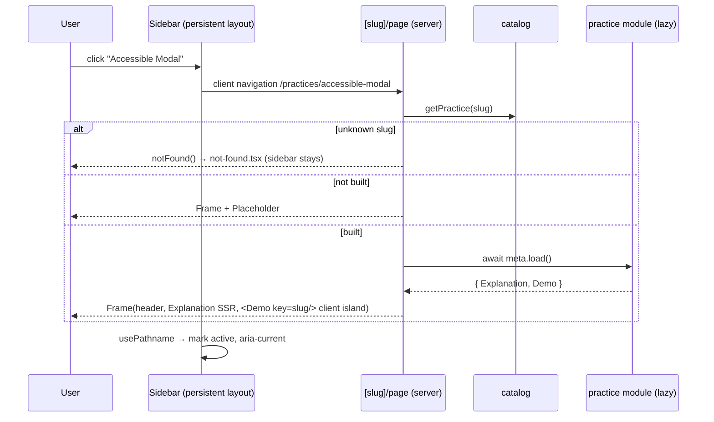

# Technical Design: React Practice Playground (Shell)

## Scope

**In scope:** the playground shell: route structure, the practice catalog,
the sidebar (desktop and mobile drawer, active state, filter), the overview
page, the practice page frame (header, explanation, controls slot, demo
stage with error boundary), not-found handling, theming fixes, and 14
"coming soon" placeholders.

**Out of scope:** any practice's demo logic (features 002–015), mock API
endpoints for practices (added by the practice that needs them), and
automated tests (per decisions.md).

## Research Summary

> Sources: bundled Next.js 16.3.8 docs (`node_modules/next/dist/docs/`), shadcn CLI 4.21 registry dry-run, ui-ux-pro-max design-system search.

- **Dynamic routes:** `params` is a `Promise`. The global `PageProps<'/practices/[slug]'>` helper types it, and `generateStaticParams` pre-renders known slugs.
- **Error boundaries changed:** `error.tsx` receives `retry` (re-fetch + re-render), not the older `reset`. For a component-level boundary, `catchError(fallback)` from `next/error` creates one that works with `notFound()`/`redirect()` and clears automatically on client navigation. It fits AC-013 exactly (demo-only boundary).
- **Not found:** calling `notFound()` in a page renders the nearest `not-found.tsx` *inside* the surrounding layouts, so the sidebar stays visible.
- **shadcn `sidebar`** (base-nova) adds `sidebar`, `sheet`, `tooltip`, `separator`, `skeleton` and the `use-mobile` hook. On mobile it renders a Sheet (Base UI dialog: focus trap, Escape, outside-click, focus return), which covers AC-017/018 without custom code. The shell isn't a practice, so the no-lib rule doesn't apply here.
- **ui-ux-pro-max:** its suggested *pattern* (FAQ landing) and *style* (exaggerated minimalism, 12rem type) don't fit a dense tool layout and are rejected. Kept: developer typography (sans body + mono accents), a calm slate/neutral surface with a single green "built/run" accent, visible focus rings, 150–300 ms transitions, reduced-motion support, no emoji icons (lucide), and checks at 375/768/1024/1440.

## Patterns & Reuse

### Conventions to Follow

| Pattern | Project Uses | Avoid | Reference |
|---------|-------------|-------|-----------|
| Path alias | `@/*` → `src/*` | relative `../../` chains | tsconfig.json:22 |
| Class merging | `cn()` | string concat of classes | src/lib/utils.ts |
| Typed route props | global `LayoutProps<'/'>` / `PageProps<…>` | hand-written param types | src/app/layout.tsx:21 |
| Server-only code | `import "server-only"` in `src/server/*` | importing server modules in client files | src/server/todos/todo.service.ts:1 |
| UI primitives | shadcn components in `src/components/ui` | hand-rolled buttons/inputs, a 2nd UI lib | components.json |
| Theme colors | shadcn CSS variables (`bg-background`, `text-muted-foreground`) | raw hex/oklch in components | src/app/globals.css:51 |

### Existing Code to Reuse

| Component | Location | How to Use |
|-----------|----------|------------|
| Button | src/components/ui/button.tsx | Retry, clear-filter, menu actions |
| Card | src/components/ui/card.tsx | Overview tiles, explanation and controls panels |
| Input | src/components/ui/input.tsx | Pulled in by the sidebar's filter input |
| Root layout + fonts | src/app/layout.tsx:5-13 | Keep Geist Sans/Mono; fix variable wiring |

## Data Model

### Entities

| Entity | Purpose |
|--------|---------|
| PracticeMeta | Catalog entry: identity and copy for one practice (sidebar, overview, header, metadata) |
| PracticeModule | What a *built* practice provides to the frame (explanation + demo) |

No existing types are read or modified; both are new.

#### PracticeMeta (new: `src/practices/catalog.ts`)

- `slug` (string): URL segment, kebab-case, unique
- `number` (1–14): catalog order and sidebar number
- `title` (string): full name (sidebar, header, tab title)
- `summary` (string): one line (overview, header)
- `load?` (`() => Promise<PracticeModule>`): present only when the practice is built. **Status is derived:** `load` present means built, absent means coming soon. This is the single switch a practice feature flips.

#### PracticeModule (new: default export of `src/practices/{slug}/index.ts`)

- `Explanation` (React Server Component): key techniques and trade-offs
- `Demo` (Client Component): renders optional `<DemoControls>` and a `<DemoStage>`

### Relationships

One catalog → 14 PracticeMeta (static array). PracticeMeta 0..1 → PracticeModule via `load`.

### API Contracts

None. The shell has no endpoints.

## Decisions

| Decision | Rationale |
|----------|-----------|
| Routes: `/` = overview, `/practices/[slug]` = practice, both inside route group `(playground)` with a shared layout holding the sidebar | The sidebar persists across navigations (layouts don't re-render); the URL per practice covers AC-006/007; the group keeps the root layout minimal |
| `generateStaticParams` from the catalog, plus `notFound()` for unknown slugs; `not-found.tsx` inside the group | All 14 pages pre-render (fast switching: success criterion); unknown slug shows not-found with the sidebar still visible (AC-008) |
| Static catalog in plain TS, with a lazy `load: () => import("./{slug}")` per built practice | Only the opened practice's module is loaded (AC-012); adding a practice = its own folder + its catalog line, never touching shell code (Goal 4). Shell components read the catalog and never import practices directly |
| Frame split: header + Explanation render on the server; `Demo` is a client island | Explanation is static text, so it ships no JS (vercel: server-first, bundle size); only interactive parts hydrate |
| Demo boundary via `catchError` wrapping `<DemoStage>`, with a Retry button calling `retry()`; plus `error.tsx` in `[slug]` as backstop | AC-013: the error stays inside the demo area; the sidebar and explanation keep working; state outside the boundary survives |
| `Demo` rendered with `key={slug}` | Guarantees a remount between practices, so practices' effect cleanups always run (edge case: stop pending activity) |
| Controls are opt-in: practices render `<DemoControls>` only if they have any | AC-011 needs no frame logic; nothing renders when it's not used |
| shadcn `Sidebar` (`collapsible="offcanvas"`), with `SidebarTrigger` in a sticky top bar shown below `md` | Mobile drawer, focus trap, Escape/outside click, focus return all built in (AC-017/018); a narrow→wide resize swaps the Sheet for the fixed sidebar automatically (edge case) |
| Close the mobile drawer on item click via `setOpenMobile(false)` | AC-019 |
| Active item: client `usePathname()` in a small nav island; `isActive` + `aria-current="page"` | AC-003; the rest of the sidebar stays server-rendered |
| Sidebar items are real `<Link>`s rendered on the server | Works before hydration (edge case: no JS yet); keyboard reachable with focus ring (AC-005) |
| Filter: client state in the nav island, case-insensitive `includes` on the title, "No matches" + Clear button | AC-021/022; 14 items need no debounce or memoization |
| Truncate titles with `truncate` + `title` attribute; full text stays in the DOM | Edge case: long names (screen readers read full text) |
| Theme follows the OS: change `@custom-variant dark` to `@media (prefers-color-scheme: dark)` and move the `.dark` block under that media query | Spec's no-toggle decision; today dark mode never activates because nothing sets `.dark` |
| Fix `--font-sans` (currently self-referencing) to `var(--font-geist-sans)` | Today the body silently falls back to the system font |
| Typography: Geist Sans body, Geist Mono for practice numbers, slugs and code-ish labels | Same role as ui-ux-pro-max's dev pairing (Plex + JetBrains) but already self-hosted via `next/font`: zero extra requests |
| Palette: keep shadcn neutral tokens; add one `--success` token (green, AA contrast in both themes) for "built" badges and the progress count | Minimal color, one semantic accent; "coming soon" uses `muted` (status also shown as text, not color alone) |
| Motion: Sheet/hover transitions 150–200 ms; global `prefers-reduced-motion` rule disables animation/transition durations | Edge case: reduced motion |
| Metadata: root `title.template = "%s · React Practices"`; `generateMetadata` per practice | AC-009 |
| Default `src/app/page.tsx` is replaced by the group's overview page | One `/` route; removes create-next-app boilerplate |

## Component Design

| Component | File | Action | Responsibility |
|-----------|------|--------|----------------|
| shadcn sidebar set | src/components/ui/{sidebar,sheet,tooltip,separator,skeleton}.tsx, src/hooks/use-mobile.ts | new (CLI) | Generated primitives; not edited |
| Practice catalog | src/practices/catalog.ts | new | 14 PracticeMeta entries, `getPractice(slug)`, `isBuilt()`, types |
| Placeholder modules | n/a | none | Unbuilt practices have no module; frame shows the placeholder |
| Root layout | src/app/layout.tsx | modify | Metadata template, fonts, `lang`, body background |
| Theme CSS | src/app/globals.css | modify | OS dark mode, font fix, `--success` token, reduced-motion rule |
| Default home | src/app/page.tsx | delete | Replaced by the overview |
| Playground layout | src/app/(playground)/layout.tsx | new | `SidebarProvider` + `AppSidebar` + `SidebarInset` + mobile top bar |
| AppSidebar | src/components/playground/app-sidebar.tsx | new (server) | Brand header, built count, wraps `PracticeNav` |
| PracticeNav | src/components/playground/practice-nav.tsx | new (client) | Filter input, list, active state, close drawer on select, empty state |
| MobileTopBar | src/components/playground/mobile-top-bar.tsx | new | `SidebarTrigger` (labelled "Open practices menu") + title, `md:hidden` |
| StatusBadge | src/components/playground/status-badge.tsx | new | "Built" (success) / "Coming soon" (muted), text + color |
| Overview page | src/app/(playground)/page.tsx | new (server) | Heading, "N of 14 built", responsive card grid of all practices |
| Practice page | src/app/(playground)/practices/[slug]/page.tsx | new (server) | `generateStaticParams`, `generateMetadata`, `notFound()`, loads the module, renders `PracticeFrame` |
| Practice error backstop | src/app/(playground)/practices/[slug]/error.tsx | new (client) | Frame-level fallback with `retry()` |
| Not found | src/app/(playground)/not-found.tsx | new | Message + link to overview (sidebar stays) |
| PracticeFrame | src/components/playground/practice-frame.tsx | new (server) | Header (number, title, summary, status), Explanation card, then Demo or Placeholder |
| PracticePlaceholder | src/components/playground/practice-placeholder.tsx | new | "Coming soon" panel with title and summary (AC-004) |
| DemoControls | src/components/playground/demo-controls.tsx | new (client) | Labelled card/region for knobs; used by practices |
| DemoStage | src/components/playground/demo-stage.tsx | new (client) | Bordered demo region wrapped in a `catchError` boundary with a Retry fallback |

## Data Flow

## Requirements Traceability

| Requirement | Component | File | Status |
|-------------|-----------|------|--------|
| AC-001 | AppSidebar, PracticeNav | src/components/playground/app-sidebar.tsx, practice-nav.tsx | Planned |
| AC-002 | Playground layout + Link navigation | src/app/(playground)/layout.tsx | Planned |
| AC-003 | PracticeNav (`isActive`, `aria-current`) | src/components/playground/practice-nav.tsx | Planned |
| AC-004 | StatusBadge, PracticePlaceholder | src/components/playground/status-badge.tsx, practice-placeholder.tsx | Planned |
| AC-005 | Links + focus ring | src/components/playground/practice-nav.tsx | Planned |
| AC-006 | Practice page + generateStaticParams | src/app/(playground)/practices/[slug]/page.tsx | Planned |
| AC-007 | URL routing (browser history) | src/app/(playground)/practices/[slug]/page.tsx | Planned |
| AC-008 | notFound() + not-found.tsx | src/app/(playground)/not-found.tsx | Planned |
| AC-009 | generateMetadata + title template | [slug]/page.tsx, src/app/layout.tsx | Planned |
| AC-010 | PracticeFrame order | src/components/playground/practice-frame.tsx | Planned |
| AC-011 | Opt-in DemoControls | src/components/playground/demo-controls.tsx | Planned |
| AC-012 | Lazy `load()` per practice | src/practices/catalog.ts | Planned |
| AC-013 | DemoStage `catchError` + error.tsx | src/components/playground/demo-stage.tsx, [slug]/error.tsx | Planned |
| AC-014 | Overview grid | src/app/(playground)/page.tsx | Planned |
| AC-015 | Overview card links | src/app/(playground)/page.tsx | Planned |
| AC-016 | Built count | src/app/(playground)/page.tsx, src/practices/catalog.ts | Planned |
| AC-017 | Sidebar offcanvas + MobileTopBar | src/app/(playground)/layout.tsx, mobile-top-bar.tsx | Planned |
| AC-018 | Sheet focus trap / Escape / outside click | src/components/ui/sidebar.tsx (shadcn) | Planned |
| AC-019 | setOpenMobile(false) on select | src/components/playground/practice-nav.tsx | Planned |
| AC-020 | Responsive layout, `min-w-0` content | src/app/(playground)/layout.tsx | Planned |
| AC-021 | Filter | src/components/playground/practice-nav.tsx | Planned |
| AC-022 | No-match state + clear | src/components/playground/practice-nav.tsx | Planned |

## Test Strategy

### Infrastructure

| Aspect | Detail |
|--------|--------|
| Framework | None (no automated tests; decisions.md) |
| Command | `pnpm typecheck && pnpm lint && pnpm build` (quality gate) |
| Location | n/a |

### Reference Tests

None in the repository.

### New Tests

No automated tests. Verification per task is manual, in a real browser on a production build: navigate all 14 items, refresh, back/forward, unknown slug, keyboard-only pass, 360px viewport drawer behavior, OS dark mode, reduced motion, and a forced demo error (via a temporary throwing demo, removed after the check). An automated a11y audit (Lighthouse/axe in browser devtools) is used for the success criterion.

## Considerations

### Error Handling

- Unknown slug → `notFound()` (404 status, not-found UI inside the layout).
- Demo runtime error → `catchError` boundary in DemoStage (Retry); anything the stage boundary misses (e.g. an Explanation render error) → `[slug]/error.tsx` with `retry()`.
- A rejected `load()` (module import failure) throws during the page render and is caught by `error.tsx`.

### Security

- No user input reaches the server; the slug is matched against a static list before use, so dynamic imports never take user-controlled paths.

### Practice author contract (original plan, superseded; see Deviations)

1. Create `src/practices/{slug}/index.ts` default-exporting `{ Explanation, Demo }`.
2. Add `load: () => import("./{slug}")` to its catalog entry.
3. Inside `Demo`: optional `<DemoControls>`, then `<DemoStage>`; clean up timers, requests and streams in effect cleanups.
4. Mock endpoints go in `src/app/api/practices/{slug}/` backed by `src/server/practices/{slug}/`.

## Deviations (applied during implement)

| Planned | Actual | Why |
|---------|--------|-----|
| Lazy `load: () => import()` map in the catalog, one `[slug]` page | **One route file per built practice** at `src/app/(playground)/practices/{slug}/page.tsx`; `[slug]` only serves unbuilt practices (placeholder) and unknown slugs (404). Catalog entries carry an explicit `built` flag | T011 measured that Turbopack emitted every practice's client chunk as a `<script>` on every `[slug]` page (and on all pages while the layout imported the loader map). Route files give per-practice code splitting for free |
| `PracticeModule` `{ Explanation, Demo }` contract | `PracticeFrame` takes `explanation` and `demo` as React nodes from the practice's route file | No module registry is needed once each practice owns its route |
| Mobile-only top bar (`md:hidden`) | Top bar with the sidebar toggle at all widths (brand text only on mobile); trigger is 44 px on mobile | The provider's Cmd/Ctrl+B shortcut collapses the desktop sidebar, so a visible way to reopen it is needed; 44 px meets the touch-target rule |
| Use generated `use-mobile` hook as-is | Rewritten with `useSyncExternalStore` (same API) | The generated hook fails the React Compiler lint rule (setState in effect) |
| `[slug]` `generateStaticParams` for all 14 slugs | Only unbuilt slugs; `[slug]` throws a descriptive error if a `built: true` practice has no route | Keeps the catalog flag and the route files consistent |

### Practice author contract (supersedes the section above)

1. Put the practice code in `src/practices/{slug}/`: `explanation.tsx` (Server Component) and `demo.tsx` (`"use client"`; optional `<DemoControls>`, then `<DemoStage>`; clean up in effects).
2. Add `src/app/(playground)/practices/{slug}/page.tsx`: `export const metadata = practiceMetadata(slug)`, and render `<PracticeFrame practice={getPractice(slug)!} explanation={<Explanation />} demo={<Demo />} />`.
3. Set `built: true` on its catalog entry.
4. Mock endpoints go in `src/app/api/practices/{slug}/`, backed by `src/server/practices/{slug}/`.

## Open Questions

- [x] Per-practice chunk loading: resolved by the per-route deviation; verified in a production build (probe chunk referenced only on its own page, 0 times on `/` and other practices).
