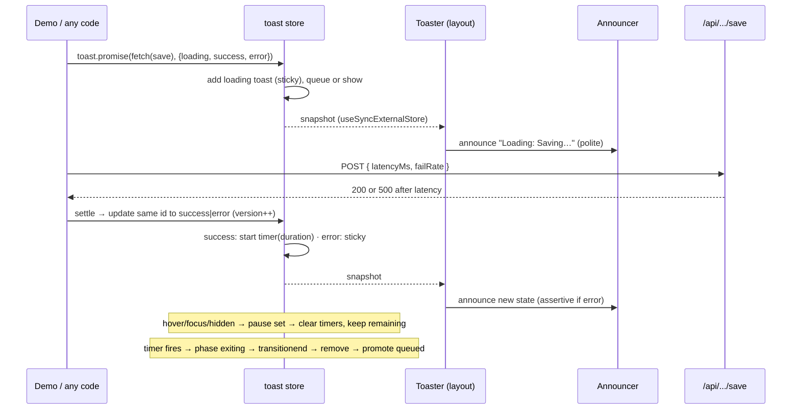

# Technical Design: Toast / Notification System

## Scope

**In scope:** a hand-built, app-wide toast service (store, queue, timers,
pause reasons, duplicate merging, async tracking), the toast area UI
(positions, enter/exit/reflow motion, remaining-time bar, "+N more",
Dismiss all), screen-reader announcements and the F8/Escape keyboard model,
a mock "save" endpoint with latency and failure injection, and the practice
page (explanation + demo controls + demo).

**Out of scope:** swipe-to-dismiss, collapsed deck, history, persistence,
rich content (spec Out of Scope); automated tests (cross-practice decision).

## Research Summary

> Sources: Tailwind 4.3.3 dist (`starting:` variant → `@starting-style`), ui-ux-pro-max UX rules, WAI-ARIA live-region practice, React 19 `useSyncExternalStore`.

- **Live regions must already exist in the DOM** before text is written into them, or screen readers may miss the first announcement. Use two always-mounted, visually hidden regions: polite (`role="status"`) and assertive (`role="alert"`). Toast items themselves are *not* live regions, so nothing is announced twice.
- **CSS-only enter animation:** Tailwind v4's `starting:` variant compiles to `@starting-style`, so an element can transition from its starting style on first render with no JS measuring (Chrome 117+, Safari 17.5+, Firefox 129+). Older browsers just show the toast without animation, which is acceptable.
- **Smooth reflow (AC-006) without FLIP measuring:** wrap each toast in a grid with `grid-template-rows: 1fr → 0fr` on exit. The collapsing row animates height, so neighbours slide into the freed space.
- **ui-ux-pro-max:** enter with ease-out (~200 ms), exit with ease-in at about 65% of that (~130 ms); never steal focus; polite announcements; Undo for destructive actions. Its "toasts must auto-dismiss" rule conflicts with the user's sticky-errors decision; the decision stands (WCAG 2.2.1: users can't miss errors or actions).
- **`useSyncExternalStore`** lets any component subscribe to a module-level store, and lets non-React code (event handlers, other practices, promise callbacks) raise toasts without a context provider. The server snapshot is a constant empty state, so SSR is safe.

## Patterns & Reuse

### Conventions to Follow

| Pattern | Project Uses | Avoid | Reference |
|---------|-------------|-------|-----------|
| Practice registration | Own route file + `built: true` | Touching the `[slug]` page | .artifacts/features/001-practice-playground/design.md (Deviations) |
| Practice layout | `PracticeFrame` with `explanation` + `demo` | Custom page chrome | src/components/playground/practice-frame.tsx:7 |
| Demo composition | `DemoControls` then `DemoStage` | Unbounded demo errors | src/components/playground/demo-controls.tsx:5, demo-stage.tsx:34 |
| API handlers | Thin route → Zod `parseBody` → service; `{ error: { message } }` | Logic in route files | src/app/api/todos/route.ts:9, src/lib/http.ts:16 |
| Server logic | `import "server-only"` services in `src/server/` | Importing server code in client | src/server/todos/todo.service.ts:1 |
| Theme colors | Tokens (`text-success`, `text-destructive`, `bg-card`) | Raw colors | src/app/globals.css:31 |
| Global listeners | One listener per event, attached in one place | Per-toast `keydown`/`visibilitychange` listeners | vercel `client-event-listeners` |

### Existing Code to Reuse

| Component | Location | How to Use |
|-----------|----------|------------|
| Button | src/components/ui/button.tsx | Close, action, Dismiss all, demo buttons |
| Card | src/components/ui/card.tsx | Demo "items" list for the Undo flow |
| `parseBody`, `jsonError` | src/lib/http.ts:16, :5 | Mock save endpoint |
| `cn()` | src/lib/utils.ts | Class merging |
| lucide icons | dependency | CheckCircle2, XCircle, Info, TriangleAlert, Loader2, X |

## Data Model

### Entities

| Entity | Purpose |
|--------|---------|
| Toast | One notification and its lifecycle state |
| ToasterSettings | App-wide position, max visible, default duration |
| ToastState | Snapshot read by the UI: ordered toasts + settings + pause flag |
| SaveRequest / SaveResponse | Mock endpoint contract for the async demo |

No existing types are read or modified; all are new.

#### Toast (new: `src/practices/toast-notifications/toast-store.ts`)

- `id` (string): unique per toast
- `type` ("success" | "error" | "info" | "warning" | "loading")
- `title` (string, non-empty), `description?` (string)
- `action?` ({ label: string; onAction: () => void | Promise<void> })
- `count` (number ≥ 1): merged duplicates
- `duration` (ms | null): `null` means sticky (errors, actions, loading)
- `remaining` (ms | null): time left; set when visible
- `phase` ("queued" | "visible" | "exiting")
- `createdAt` (number): FIFO order
- `version` (number): bumps on in-place update or merge (restarts the bar animation, re-announces)

#### ToasterSettings

- `position` ("top-left" | "top-center" | "top-right" | "bottom-left" | "bottom-center" | "bottom-right"), default "bottom-right"
- `maxVisible` (1–6), default 3
- `duration` (1000–15000 ms), default 5000

#### ToastState (immutable snapshot)

- `toasts` (Toast[]: visible and exiting first in display order, then queued)
- `queuedCount` (number)
- `paused` (boolean): any pause reason active
- `settings` (ToasterSettings)

### Relationships

ToastState 1 → many Toast; ToastState 1 → 1 ToasterSettings. The duplicate key is `type|title|description`, at most one live toast per key.

### API Contracts

| Endpoint | Method | Request | Response |
|----------|--------|---------|----------|
| `/api/practices/toast-notifications/save` | POST | `{ latencyMs: 0–10000, failRate: 0–1 }` | `200 { data: { savedAt: string } }` or `500 { error: { message: "Simulated server failure" } }`; `422` on invalid body, `400` on bad JSON |

### Currently Exposed Fields

No AC enumerates fields from existing code; none needed.

## Decisions

| Decision | Rationale |
|----------|-----------|
| **Module-level store + `useSyncExternalStore`**, exposing a `toast` API (`toast.success/error/info/warning`, `toast.promise`, `toast.dismiss`, `toast.dismissAll`) and `configureToaster()` | Callable from anywhere (event handlers, promise callbacks, other practices) with no provider (AC-036); the subscription is fine-grained; immutable snapshots fit React's model |
| Store mutations only on the client (from events/effects); server snapshot = constant empty state | Avoids shared server module state across requests (vercel `server-no-shared-module-state`) |
| **`<Toaster />` mounted once in `src/app/(playground)/layout.tsx`**, outside `SidebarInset` and the demo's error boundary | Survives navigation (AC-035); a crashing demo can't take the toasts down (edge case). This is an intentional, one-line exception to 001's "practices don't touch shell code" goal, required by the app-wide decision |
| Timers: one `setTimeout` per *visible, timed* toast, using `remaining` and a `startedAt` timestamp (`performance.now()`) | Pause = clear the timeout and subtract elapsed; resume = reschedule with `remaining`. Exact to the event loop (≪100 ms) |
| **Pause reasons as a set** (`hover`, `focus`, `hidden`); paused = set not empty | Hover + focus + hidden can overlap; one source of truth avoids resuming too early (AC-026/027/037) |
| Queue: display order = visible (by `createdAt`) then queued FIFO; promote on dismissal; lowering `maxVisible` demotes the newest visible ones to the front of the queue | AC-007/008 and edge case; demoted toasts keep their `remaining` |
| Duplicate merge: same key → `count++`, `version++`, reset `remaining` to `duration` if visible; a queued duplicate keeps its queue place | AC-033/034, edge case |
| Exit: `phase: "exiting"` → CSS exit (opacity + grid-rows collapse, 130 ms ease-in) → removed after `transitionend`, with a 300 ms fallback timer | Smooth exit and reflow (AC-005/006) without an animation library; the fallback covers reduced motion and skipped transitions |
| Enter: `starting:` variant (translate from the anchored edge + opacity), 200 ms ease-out | AC-005, no JS measuring |
| Newest toast nearest the screen edge: bottom positions use `flex-col` with the newest last; top positions `flex-col-reverse` | AC-029 |
| Remaining-time bar: CSS `@keyframes` scaleX 1→0 over `duration`, `animation-play-state: paused` while paused, remounted per `version`; hidden under reduced motion | AC-028; zero JS per frame |
| **Announcer:** two hidden live regions inside `<Toaster />`; on visible-enter and on `version` change, write "{Type}: {title}. {description}" into polite (or assertive for errors), clearing first and writing on the next frame | AC-011/012/013/025; re-announces identical text |
| Keyboard: one `keydown` listener on `window` for F8 (focus newest toast, remember previously focused element); Escape handled on the toast list | AC-014/015; one global listener |
| Toast items are `<li tabIndex={0}>` in an `<ol aria-label="Notifications">` inside a `<section aria-label="Notifications (F8)">` region | Reachable and labelled; not a live region (no double announcements); never auto-focused (AC-016) |
| `toast.promise(p, { loading, success, error })`: one toast id, updated in place; races a 30 s timeout | AC-021–023, edge case; the same toast is updated, never replaced |
| Action: run `onAction` once (guard flag), dismiss, and on throw/rejection raise an error toast with the message | AC-018, edge case |
| Empty title → `console.error` with a clear message, return no id, show nothing | Edge case: "reject and report to the developer" without crashing an event handler |
| Mobile (<640 px): toast area spans the full width with 16 px side margins at the top or bottom edge | AC-032 |
| Mock save endpoint: Zod-validated body, `setTimeout(latencyMs)`, fail with probability `failRate` | Real network behavior with controlled latency and failure (AC-024), following the API conventions |
| Demo settings live in the store (`configureToaster`), so controls change the real app-wide toaster | AC-029/030; what you tune is what other practices get |

## Component Design

| Component | File | Action | Responsibility |
|-----------|------|--------|----------------|
| Toast store | src/practices/toast-notifications/toast-store.ts | new | State, queue, timers, pause reasons, merge, promise tracking, `toast` API, `useToastState()` |
| Toaster | src/practices/toast-notifications/toaster.tsx | new (client) | Region, positioning, hover/focus/visibility pause wiring, F8/Escape, "+N more", Dismiss all, announcer |
| ToastItem | src/practices/toast-notifications/toast-item.tsx | new (client) | One toast: icon, text, count, action, close, progress bar, enter/exit transitions |
| Announcer | src/practices/toast-notifications/announcer.tsx | new (client) | Two live regions + `announce(text, urgency)` |
| Demo | src/practices/toast-notifications/demo.tsx | new (client) | Controls (type buttons, position, duration, max visible, latency, failure rate, burst, dismiss all) + stage (Undo list, Save button) |
| Explanation | src/practices/toast-notifications/explanation.tsx | new (server) | Notes: live regions, timers with remaining time, queue, in-place updates |
| Route | src/app/(playground)/practices/toast-notifications/page.tsx | new | `PracticeFrame` with explanation + demo, metadata |
| Catalog | src/practices/catalog.ts | modify | `built: true` for toast-notifications |
| Playground layout | src/app/(playground)/layout.tsx | modify | Mount `<Toaster />` |
| Save schema | src/server/practices/toast-notifications/save.schema.ts | new | Zod request schema + response type |
| Save service | src/server/practices/toast-notifications/save.service.ts | new | Latency + failure simulation |
| Save route | src/app/api/practices/toast-notifications/save/route.ts | new | Thin handler |

## Data Flow

## Requirements Traceability

| Requirement | Component | File | Status |
|-------------|-----------|------|--------|
| AC-001 | ToastItem, store | toast-item.tsx, toast-store.ts | Planned |
| AC-002 | store timers | toast-store.ts | Planned |
| AC-003 | store (`duration: null` for errors) | toast-store.ts | Planned |
| AC-004 | ToastItem close button | toast-item.tsx | Planned |
| AC-005 | ToastItem transitions | toast-item.tsx | Planned |
| AC-006 | ToastItem grid-rows collapse | toast-item.tsx | Planned |
| AC-007 | store queue | toast-store.ts | Planned |
| AC-008 | store promote + timer start on visible | toast-store.ts | Planned |
| AC-009 | Toaster "+N more" | toaster.tsx | Planned |
| AC-010 | store `dismissAll`, Toaster + Demo button | toast-store.ts, toaster.tsx, demo.tsx | Planned |
| AC-011 | Announcer polite | announcer.tsx, toaster.tsx | Planned |
| AC-012 | Announcer assertive | announcer.tsx | Planned |
| AC-013 | Announce on visible-enter | toaster.tsx | Planned |
| AC-014 | F8 listener | toaster.tsx | Planned |
| AC-015 | Escape + focus restore | toaster.tsx | Planned |
| AC-016 | No auto-focus | toaster.tsx, toast-item.tsx | Planned |
| AC-017 | ToastItem action button | toast-item.tsx | Planned |
| AC-018 | store action guard | toast-store.ts | Planned |
| AC-019 | store (`duration: null` with action) | toast-store.ts | Planned |
| AC-020 | Demo Undo list | demo.tsx | Planned |
| AC-021 | `toast.promise` loading | toast-store.ts, toast-item.tsx | Planned |
| AC-022 | in-place success + timer | toast-store.ts | Planned |
| AC-023 | in-place error, sticky | toast-store.ts | Planned |
| AC-024 | Save endpoint + Demo | save.service.ts, route.ts, demo.tsx | Planned |
| AC-025 | Announce on version change | toaster.tsx | Planned |
| AC-026 | hover pause reason | toaster.tsx, toast-store.ts | Planned |
| AC-027 | hidden pause reason | toaster.tsx, toast-store.ts | Planned |
| AC-028 | progress bar play-state | toast-item.tsx | Planned |
| AC-029 | positions + order | toaster.tsx, demo.tsx | Planned |
| AC-030 | `configureToaster` + controls | toast-store.ts, demo.tsx | Planned |
| AC-031 | Burst button | demo.tsx | Planned |
| AC-032 | mobile full width | toaster.tsx | Planned |
| AC-033 | merge | toast-store.ts | Planned |
| AC-034 | key includes type/title/description | toast-store.ts | Planned |
| AC-035 | Toaster in layout | src/app/(playground)/layout.tsx | Planned |
| AC-036 | module-level `toast` API | toast-store.ts | Planned |
| AC-037 | focus pause reason | toaster.tsx, toast-store.ts | Planned |

## Test Strategy

### Infrastructure

| Aspect | Detail |
|--------|--------|
| Framework | None (cross-practice decision: no automated tests) |
| Command | `pnpm typecheck && pnpm lint && pnpm build` |
| Location | n/a |

### Reference Tests

None.

### New Tests

No automated tests. Verification in a real browser on a production build:
timer accuracy (log `performance.now()` at show and remove for 10 toasts,
with hover, focus and hidden pauses), a 50-toast burst with a long-task
observer (`PerformanceObserver` `longtask`), live-region text after each
toast, F8/Escape focus movement, all six positions, mobile width, reduced
motion, axe-core on the page with toasts visible, and navigation persistence.

## Considerations

### Error Handling

- Action throws or rejects → toast dismissed, error toast with the message; never rethrown into React.
- `toast.promise` rejects → the same toast becomes an error with `error(err)` text (default "Something went wrong"); 30 s timeout → "Timed out".
- Save endpoint: 400 bad JSON, 422 invalid range, 500 simulated failure, all in the project's error shape; the demo reads `error.message` for the toast.
- Store misuse (empty title) → `console.error`, no throw.

### Security

- Toast text is rendered as text (React escaping), never as HTML.
- The save endpoint caps `latencyMs` at 10 s so requests can't hang the server.

### Performance

- Snapshot is rebuilt only on mutations; `ToastItem` is memoized by `id` + `version` + `phase`, so timers ticking elsewhere never re-render other toasts (there are no per-frame ticks at all: progress is CSS).
- A 100+ queue renders only visible toasts; queued ones contribute only to the "+N more" count.

## Deviations (applied during implement)

| Planned | Actual | Why |
|---------|--------|-----|
| Remove an exiting toast on `transitionend` with a fallback | Store always removes it 200 ms after dismissal (exit transition is 130 ms) | One deterministic path; works with reduced motion and skipped transitions |
| Merge all identical toasts | Toasts with an action, and loading toasts, never merge | Each carries its own callback or settles independently |
| Remaining-time bar as CSS keyframes | Web Animations API with `currentTime` offset + pause/play | Colocated with the component, no global CSS; resumes exactly where it paused |
| Existing tokens only | Added `--info` and `--warning` theme tokens (both themes) | Type colors need tokens; raw colors are against the rules |
| Burst raises the same 10 toasts | Each burst run is labelled "Burst #n" | Repeated bursts would merge, making the 50-toast measurement impossible |

## Open Questions

- None.
