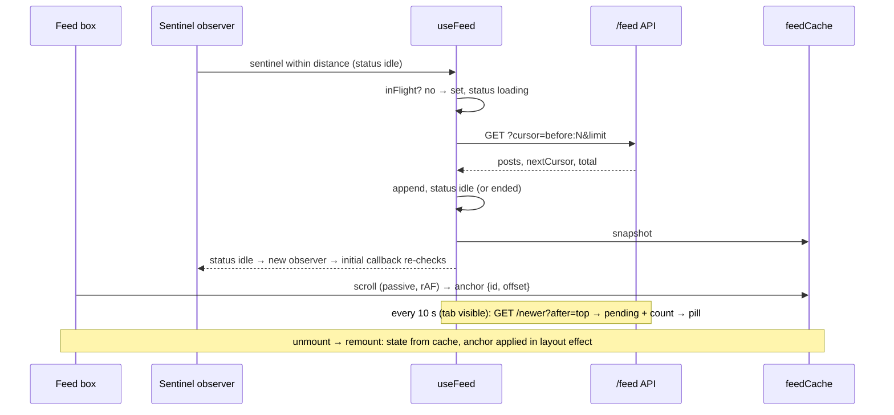

# Technical Design: Infinite Scroll

## Scope

**In scope:** a mock feed backend (in-memory store of ~500 posts, cursor
paging, newer-posts check, simulate endpoint, latency/failure injection), a
feed hook (paging state machine, single-flight guard, abort, polling,
pending new posts), the feed UI (scroll box, sentinel observer, Load more,
error/end rows, new-posts pill, Back to top, ARIA feed pattern with
Page Up/Down), an in-memory restoration cache, demo controls with request
stats, and the explanation.

**Out of scope:** windowing (practice 7), two-way loading (practice 5),
images (practice 11), restoration across full reloads, push updates,
automated tests.

## Research Summary

> Sources: WAI-ARIA APG Feed pattern, MDN IntersectionObserver, vercel-react-best-practices, ui-ux-pro-max.

- **APG Feed:** a container with `role="feed"` and `aria-busy` while loading; each post is an `article` that is focusable, labelled, and carries `aria-posinset` / `aria-setsize` (`-1` when unknown). Page Down/Page Up move focus between articles. The feed must not move focus when content loads.
- **IntersectionObserver with a custom root:** observing a sentinel element at the end of the list, with `root` = the scroll box and `rootMargin: 0px 0px {distance}px 0px`, fires when the end comes within `distance` px. No scroll listener runs for the trigger. An observer fires its initial callback on `observe()`, which is used to re-check after each page ("fill the box", AC-005) instead of polling geometry.
- **Cursor paging:** the client sends back an opaque marker meaning "posts older than X". New posts get higher sequence numbers and never shift older pages, so there are no duplicates or gaps (AC-024). Offset paging would shift by the number of inserted posts.
- **Stable position:** appending below never moves content above. The only insertion above the reader is the explicit pill action, followed by a deliberate scroll to the top.
- **vercel-react-best-practices:** a passive scroll listener (`client-passive-event-listeners`), throttled to one rAF, writes transient values (scroll anchor) to a ref/cache instead of state (`rerender-use-ref-transient-values`); "Back to top" visibility is stored as a derived boolean that only changes at the threshold (`rerender-derived-state`).
- **ui-ux-pro-max:** skeleton rows for loads over 300 ms; restore position on Back (`state-preservation`); reduced motion. Its "avoid nested scroll regions" rule conflicts with the inner-box decision: mitigated with `overscroll-behavior: contain` so the page doesn't scroll-chain. Its "virtualize 50+ items" rule is deliberately deferred to practice 7.

## Patterns & Reuse

### Conventions to Follow

| Pattern | Project Uses | Avoid | Reference |
|---------|-------------|-------|-----------|
| Practice registration | Own route + `built: true` | Touching `[slug]` | src/app/(playground)/practices/searchable-accordion/page.tsx |
| API | Thin routes → Zod → `server-only` service; `{ error: { message } }` | Logic in routes | src/app/api/practices/searchable-accordion/faq/route.ts |
| Mock data store | Module-level in-memory store | Per-request globals | src/server/practices/infinite-scroll/feed.store.ts |
| Data loading | Fetch with `AbortController`; "loading" set in handlers, not synchronously in effects | setState-in-effect | src/practices/searchable-accordion/demo.tsx |
| JSX handlers | Named `handleX` unless a one-line call | Multi-line inline handlers | .claude/rules/05-event-handlers.md |
| Client singleton state | Module-level store with no server mutations | Server-shared mutable state | src/practices/toast-notifications/toast-store.ts |

### Existing Code to Reuse

| Component | Location | How to Use |
|-----------|----------|------------|
| Button, Skeleton | src/components/ui/* | Load more, Retry, pill, Back to top; placeholder rows |
| `DemoControls`, `DemoStage` | src/components/playground/* | Practice layout |
| `jsonError` | src/lib/http.ts:5 | Endpoint errors |
| `toast` (optional) | src/practices/toast-notifications/toast-store.ts | Not used: errors stay inline in the feed |

## Data Model

### Entities

| Entity | Purpose |
|--------|---------|
| Post | One feed item |
| FeedPage | One paged response |
| NewerResult | Newer-posts check response |
| FeedCacheEntry | Client restoration snapshot |

All new.

#### Post (`src/server/practices/infinite-scroll/feed.schema.ts`, shared type)

- `id` (string, `p{seq}`), `seq` (number, higher = newer), `author` (string), `handle` (string), `createdAt` (ISO string), `text` (string)

#### FeedPage

- `data` (Post[], newest first), `nextCursor` (string | null), `total` (number of posts on the server)

#### NewerResult

- `count` (number of posts newer than the given cursor), `posts` (up to 100 of the **oldest** newer posts, newest first; contiguous with the reader's top post, so inserting them never leaves a gap)

#### FeedCacheEntry (client, module-level)

- `posts`, `nextCursor`, `ended`, `total`, `pending` (Post[]), `pendingCount`, `requests`, `anchor` ({ id: string; offset: number } | null)

### API Contracts

| Endpoint | Method | Request | Response |
|----------|--------|---------|----------|
| `/api/practices/infinite-scroll/feed` | GET | `cursor?`, `limit` 10/20/50, `latencyMs` 0–10000, `failRate` 0–1 | `200 FeedPage`; `500` simulated; `422` invalid |
| `/api/practices/infinite-scroll/feed/newer` | GET | `after` (cursor of the reader's top post) | `200 { data: NewerResult }`; `422` invalid |
| `/api/practices/infinite-scroll/feed/simulate` | POST | n/a | `200 { data: { created: 3, total } }` |

Cursor = base64url of `"before:{seq}"` / `"after:{seq}"`; the server rejects anything else with 422.

### Currently Exposed Fields

No AC enumerates fields from existing code.

## Decisions

| Decision | Rationale |
|----------|-----------|
| Server store: 500 posts generated deterministically from `seq` (authors, templates, timestamps spaced 7 minutes apart); `simulate` appends 3 with `seq = max+1…` and `createdAt = now` | Realistic, reproducible data; new posts never renumber old ones |
| Page query: posts with `seq < before`, newest first, `limit`; `nextCursor = before:{last.seq}` or `null` when the oldest post is reached | Cursor paging (AC-010, AC-024, page-size-change edge case) |
| `useFeed` hook owns state: `posts`, `status` (`initial` \| `idle` \| `loading` \| `error` \| `ended`), `nextCursor`, `total`, `pending`, `requests` | One place for the paging state machine |
| Single-flight guard: an `inFlight` ref checked and set synchronously in `loadMore` | React state updates are async; a ref closes the double-request window (AC-004) |
| One `AbortController` per request, aborted on unmount and on Reset; aborted results are ignored | AC-007; no updates after unmount |
| Retry re-requests with the same `nextCursor` | AC-010 |
| Sentinel observer re-created when `status` returns to `idle` (and when `distance` or post count change); not observed while `error`/`ended`/`loading` | The initial callback re-checks "still near the end?" after each page, filling the box (AC-005) and pausing after errors (AC-009) |
| Polling: `setInterval(interval)`; skipped while `document.hidden`; on result, stores `pending` (deduped by id against loaded posts) and `pendingCount`; failures ignored | AC-020–021, edge case; newer posts are held, not inserted |
| Pill: inserts `pending` above the list, scrolls the box to top (smooth, or instant with reduced motion), announces "N new posts shown"; label caps at "99+" | AC-022, edge case |
| Restoration: module-level `feedCache` written on every state change, plus the scroll anchor (first visible post id + pixel offset) from a passive, rAF-throttled scroll listener; read in the `useState` initializer; the anchor is applied in `useLayoutEffect` before paint | AC-017–019 with zero requests; the anchor survives width changes better than raw `scrollTop`; module memory resets on full reload |
| Feed markup: `
` with `<article tabIndex={0} aria-posinset aria-setsize aria-labelledby>`; author name is the label | AC-012–013 |
| Page Down/Up: one delegated `onKeyDown` on the feed; focuses the next/previous article and `scrollIntoView({ block: "nearest" })` | AC-015, one handler |
| Live region (polite) outside the feed for "Loaded N more posts, T total" / errors / end / new posts shown | AC-014, AC-022 |
| Back to top: boolean state flipped only when crossing `2 × clientHeight`; click scrolls the box to 0 and focuses the first article with `preventScroll` | AC-025, minimal re-renders |
| `PostCard` memoized by post identity | Appending a page re-renders only new cards |
| Box: fixed height `h-[32rem]`, `overflow-y-auto`, `overscroll-behavior: contain`, `tabIndex={-1}` (not a tab stop; articles are) | Inner scroller; no scroll chaining into the page |
| Demo controls feed request options through a ref read at request time | AC-026: "applies to the next request" without re-subscribing effects |
| Stats line: "Requests: N · Posts loaded: M · Total on server: T" | AC-028 |
| Inline error row instead of a toast | The error belongs to the place in the list where loading stopped |

## Component Design

| Component | File | Action | Responsibility |
|-----------|------|--------|----------------|
| Feed schema | src/server/practices/infinite-scroll/feed.schema.ts | new | Zod query schemas, `Post`/`FeedPage`/`NewerResult` types, cursor encode/decode |
| Feed store | src/server/practices/infinite-scroll/feed.store.ts | new (`server-only`) | Generate posts, page, newer, simulate |
| Feed route | src/app/api/practices/infinite-scroll/feed/route.ts | new | GET page |
| Newer route | src/app/api/practices/infinite-scroll/feed/newer/route.ts | new | GET newer |
| Simulate route | src/app/api/practices/infinite-scroll/feed/simulate/route.ts | new | POST create 3 |
| Feed API client | src/practices/infinite-scroll/feed-api.ts | new | `fetchPage`, `fetchNewer`, `simulatePosts` |
| Feed cache | src/practices/infinite-scroll/feed-cache.ts | new | Module-level snapshot get/set/clear |
| useFeed | src/practices/infinite-scroll/use-feed.ts | new (client) | State machine, single flight, abort, polling, pending, cache sync |
| PostCard | src/practices/infinite-scroll/post-card.tsx | new | Article markup |
| FeedView | src/practices/infinite-scroll/feed-view.tsx | new (client) | Scroll box, sentinel observer, rows (loading/error/end/Load more), pill, Back to top, keyboard, anchor save/restore, live region |
| Demo | src/practices/infinite-scroll/demo.tsx | new (client) | Controls + stats + FeedView |
| Explanation | src/practices/infinite-scroll/explanation.tsx | new (server) | Notes per spec |
| Route | src/app/(playground)/practices/infinite-scroll/page.tsx | new | PracticeFrame |
| Catalog | src/practices/catalog.ts | modify | `built: true` |

## Data Flow

## Requirements Traceability

| Requirement | Component | File | Status |
|-------------|-----------|------|--------|
| AC-001 | FeedView skeleton + box | feed-view.tsx | Planned |
| AC-002 | sentinel observer + loading row | feed-view.tsx, use-feed.ts | Planned |
| AC-003 | append | use-feed.ts | Planned |
| AC-004 | inFlight ref | use-feed.ts | Planned |
| AC-005 | observer re-created on idle | feed-view.tsx | Planned |
| AC-006 | ended status + end row | use-feed.ts, feed-view.tsx | Planned |
| AC-007 | abort on unmount | use-feed.ts | Planned |
| AC-008 | Load more button | feed-view.tsx | Planned |
| AC-009 | error status + row; observer off | use-feed.ts, feed-view.tsx | Planned |
| AC-010 | retry same cursor | use-feed.ts | Planned |
| AC-011 | first-page error view | feed-view.tsx | Planned |
| AC-012 | role=feed, article posinset/setsize | feed-view.tsx, post-card.tsx | Planned |
| AC-013 | aria-busy | feed-view.tsx | Planned |
| AC-014 | live region messages | feed-view.tsx | Planned |
| AC-015 | Page Down/Up | feed-view.tsx | Planned |
| AC-016 | no focus moves on load | feed-view.tsx | Planned |
| AC-017 | cache + anchor restore | feed-cache.ts, use-feed.ts, feed-view.tsx | Planned |
| AC-018 | resume from cached cursor/pending | use-feed.ts | Planned |
| AC-019 | module memory | feed-cache.ts | Planned |
| AC-020 | polling, hidden pause | use-feed.ts | Planned |
| AC-021 | pending + pill | use-feed.ts, feed-view.tsx | Planned |
| AC-022 | insert + scroll top + announce | use-feed.ts, feed-view.tsx | Planned |
| AC-023 | simulate endpoint + control | simulate/route.ts, demo.tsx | Planned |
| AC-024 | cursor paging | feed.store.ts | Planned |
| AC-025 | Back to top | feed-view.tsx | Planned |
| AC-026 | options ref | demo.tsx, use-feed.ts | Planned |
| AC-027 | Reset | use-feed.ts, feed-cache.ts | Planned |
| AC-028 | stats line | demo.tsx | Planned |

## Test Strategy

### Infrastructure

| Aspect | Detail |
|--------|--------|
| Framework | None (cross-practice decision) |
| Command | `pnpm typecheck && pnpm lint && pnpm build` |
| Location | n/a |

### Reference Tests

None.

### New Tests

No automated tests. Browser verification on a production build: scroll through all ~500 posts (with page sizes changed and new posts simulated mid-way), checking requests = pages, unique ids, and order; first-visible-post offset before/after appends; long-task observer; navigate away/back and compare anchors with request counts; Page Down/Up; announcements; axe-core; endpoint checks with curl.

## Considerations

### Error Handling

- Page errors → inline error row + Retry; auto-loading paused; announced.
- First-page error → full error view with Retry.
- Polling errors → silent, retried next interval.
- Invalid cursor or params → 422 (client never sends them unless tampered).

### Security

- Cursors are validated by pattern; posts are rendered as text.
- Latency capped at 10 s; `newer` returns at most 100 posts; the simulate endpoint creates a fixed 3 posts, and the store caps total posts at 2,000 to bound memory.

### Performance

- No scroll listener for the trigger (observer); the passive, rAF-throttled listener only records the anchor and flips Back-to-top.
- Memoized cards; appends don't re-render existing posts.

## Open Questions

- None.
