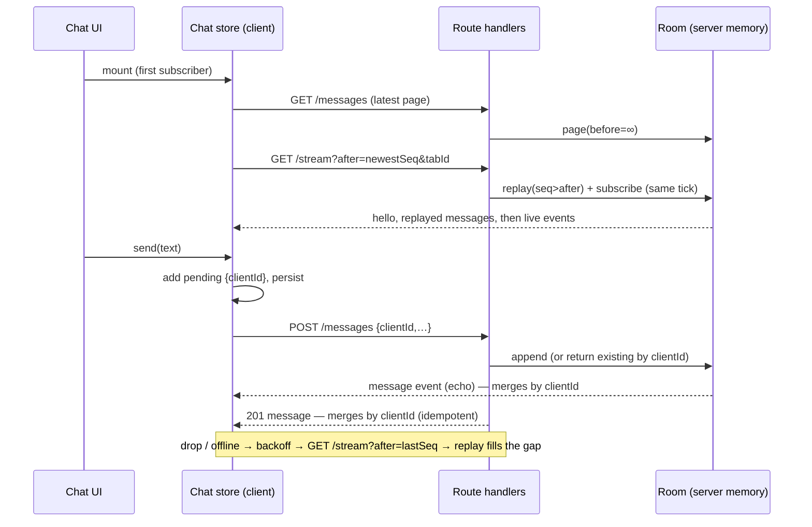

# Technical Design: Real-Time Chat UI

## Scope

**In scope:** a mock chat backend (in-memory room, history paging, idempotent
send, a server-sent-events stream with replay, typing/seen events, simulated
participants, demo control endpoint), a hand-built client chat engine
(stream reader, reconnect, message merge, pending persistence, typing and
seen throttling), the chat UI (message list with stick-to-bottom, history
anchoring, unread jump/divider, composer, status, typing line), demo
controls, explanation panel, and the practice route.

**Out of scope:** everything in the spec's Out of Scope table; list
virtualization (practice 7); reuse of the practice-4 query cache (the chat is
a push stream, not keyed request/response data, so the cache adds nothing).

## Research Summary

> Sources: bundled Next 16 docs `node_modules/next/dist/docs/01-app/02-guides/streaming.md`
> ("Streaming in Route Handlers") and `01-app/03-api-reference/03-file-conventions/route.md` (Streaming).

- A route handler can return `new Response(ReadableStream)`; Next streams the chunks as they are enqueued. This is the documented way to serve Server-Sent Events.
- Proxies, compression and `curl` buffer; send `Cache-Control: no-cache, no-transform` and `X-Accel-Buffering: no`, and test the raw stream with a small reader script, not `curl` alone.
- No `export const dynamic` is needed: the handler reads the request (query + `request.signal`), and GET route handlers are not cached by default in this version (no Cache Components config in `next.config.ts`).
- `request.signal` aborts when the client disconnects; use it to unsubscribe the stream. (Web platform behavior; verified during T002 with a reader script — flag if it doesn't fire.)

## Patterns & Reuse

### Conventions to Follow

| Pattern | Project Uses | Avoid | Reference |
|---------|-------------|-------|-----------|
| Route handlers | Thin: parse query/body with Zod → call store → `Response.json({ data })` or `jsonError` | Logic in route files | `src/app/api/practices/data-fetching-hook/users/[id]/route.ts:20` |
| Mock network | Query params `latencyMs` / `failRate`, validated by a Zod schema, applied server-side | Client-side fake delays for requests | `src/server/practices/data-fetching-hook/users.schema.ts:3`, `users.store.ts:56` |
| Server store | `import "server-only"`, module-level in-memory data, monotonically increasing `seq` | Reusing sequence numbers | `src/server/practices/infinite-scroll/feed.store.ts:4` |
| Schemas | `*.schema.ts` without `server-only` so the client imports types | Duplicated client types | `src/server/practices/infinite-scroll/feed.schema.ts:1` |
| Client API module | Small `fetch` wrappers that throw `Error(json.error.message)` on non-2xx | Fetching inside components | `src/practices/infinite-scroll/feed-api.ts:12` |
| App-wide client store | Module-level store + `useSyncExternalStore` with constant server snapshot | Context + reducer for cross-navigation state | `src/practices/toast-notifications/toast-store.ts:376`, knowledge.md Codebase Feedback |
| Practice page | Route file renders `PracticeFrame` with `Explanation` + `Demo`; catalog `built: true` | Serving through `[slug]` | `src/app/(playground)/practices/data-fetching-hook/page.tsx:8`, `src/practices/catalog.ts:43` |
| Demo layout | `<DemoControls>` + `<DemoStage>`; local `Select`/`Range`/`Checkbox` helpers per practice | Shared helper refactor of other practices | `src/practices/data-fetching-hook/demo.tsx:113` |
| Load trigger | `IntersectionObserver` on a sentinel inside the scroll box (`root: box`, `rootMargin`) | Scroll-position math to decide loading | `src/practices/infinite-scroll/feed-view.tsx:69` |
| Announcements | One visually hidden `role="status"` element updated with summaries | `aria-live` on the whole list | `src/practices/infinite-scroll/feed-view.tsx:226` |
| Handlers | Inline only for one-line calls; extract `handleX` | Multi-line inline handlers | `.claude/rules/05-event-handlers.md` |

### Existing Code to Reuse

| Component | Location | How to Use |
|-----------|----------|------------|
| `jsonError`, `parseBody` | `src/lib/http.ts:5`, `src/lib/http.ts:12` | Error shape + body validation in chat routes |
| `toast` API | `src/practices/toast-notifications/toast-store.ts:317` | `toast.warning` when reconnecting > 10 s, `toast.success("Reconnected")` after a long outage |
| `PracticeFrame` | `src/components/playground/practice-frame.tsx:8` | Page frame |
| `DemoControls`, `DemoStage` | `src/components/playground/demo-controls.tsx:5`, `demo-stage.tsx:31` | Demo layout + error boundary |
| `Button`, `Input` | `src/components/ui/button.tsx`, `input.tsx` | Composer send, Retry/Discard, name field |
| `Textarea` (new, shadcn CLI) | `pnpm dlx shadcn@latest add textarea` | Composer (multi-line, Shift+Enter) |
| catalog entry | `src/practices/catalog.ts:43-47` | Flip `built: true` |

## Data Model

### Entities

| Entity | Purpose |
|--------|---------|
| ChatMessage | A confirmed message in the room (server-owned) |
| LocalMessage | Client view model: confirmed or pending/failed, with delivery state |
| StreamEvent | One server-sent event on the live stream |
| Participant | A tab or a simulated participant (author identity) |
| RoomSettings | Demo-controlled server behavior (activity) |
| PendingRecord | Persisted unsent message (per browser) |

All entities are new (greenfield practice); no existing type is read or modified except those listed under Existing Code to Reuse.

#### ChatMessage (new, `src/server/practices/realtime-chat/chat.schema.ts`)

- `id` (string) -- server id, `m{seq}`
- `seq` (number) -- room-wide, strictly increasing, never reused; the ordering and dedupe key
- `clientId` (string) -- idempotency key from the sender (uuid); server-generated for simulated participants
- `authorId` (string) -- tab id or `bot:{name}`
- `authorName` (string) -- display name at send time (AC-036)
- `text` (string) -- 1–2000 chars after trim
- `createdAt` (string, ISO) -- server time

#### LocalMessage (new, client)

- all ChatMessage fields, with `seq`/`id`/`createdAt` absent while pending
- `state` ("sending" | "failed" | "sent" | "seen") -- own messages only; others are always "sent"
- `own` (boolean) -- `ownAuthorIds.has(authorId) || ownClientIds.has(clientId)`
- `error` (string | null) -- failure reason shown with Retry/Discard

#### StreamEvent (new, wire format `event: <type>\nid: <seq>\ndata: <json>\n\n`)

- `hello` -- `{ tabId, oldestSeq, newestSeq }` first event of every connection
- `message` -- ChatMessage; `id:` line carries `seq`
- `reset` -- `{ page: HistoryPage }` when `after` is older than the replay window (500)
- `typing` -- `{ authorId, authorName, typing: boolean }`
- `seen` -- `{ authorId, upToSeq }`
- `cleared` -- `{ byId, byName, upToSeq }` the room's history up to `upToSeq` was deleted; replayed first to a reconnecting client whose `after` is ≤ `upToSeq`
- comment `: ping` every 15 s (keep-alive; client treats 35 s of silence as dead)

#### Participant

- `id` (string) -- tab id (`tab-{uuid}`, new per page load) or `bot:{name}`
- `name` (string) -- display name, 1–32 chars (`localStorage`, random default)

#### RoomSettings (server)

- `activity` ("off" | "normal" | "burst")

#### PendingRecord (client, `localStorage["chat:pending"]`)

- `clientId`, `authorId`, `authorName`, `text`, `state` ("sending" | "failed"), `createdAt` (local)

### Relationships

Room 1─* ChatMessage; ChatMessage *─1 Participant (by `authorId`); LocalMessage 1─1 ChatMessage once confirmed, matched by `clientId`. Seen state is derived: own message `seq <= max(upToSeq of any other participant)`.

### API Contracts

All under `/api/practices/realtime-chat`. Network params (`latencyMs` -1/0–10000, `failRate` 0–1) on history and send; errors use `{ error: { message, issues? } }`.

| Endpoint | Method | Request | Response |
|----------|--------|---------|----------|
| `/messages` | GET | `?before=<seq>&limit=30&latencyMs&failRate` | `{ data: { messages: ChatMessage[] (ascending), hasMore: boolean, trimmed: boolean } }` |
| `/messages` | POST | `?latencyMs&failRate`, body `{ clientId, authorId, authorName, text }` | `201 { data: ChatMessage }`; same `clientId` again → `200` with the stored message; 422 invalid; 500 simulated |
| `/stream` | GET | `?tabId&after=<seq>` | `text/event-stream` of StreamEvents; replays `seq > after`, then live |
| `/typing` | POST | `{ authorId, authorName, typing }` | `204` |
| `/seen` | POST | `{ authorId, upToSeq }` | `204` |
| `/control` | POST | `{ action: "drop", tabId }` \| `{ action: "activity", value }` \| `{ action: "clear", authorId, authorName }` | `{ data: { activity } }` (clear: `{ data: { cleared: number } }`) |

Simulated send failure: half of failures happen **before** storing, half **after** storing but before responding (lost response) — the second kind is what proves idempotent retry (AC-010, AC-043).

### Currently Exposed Fields

| AC ID | Field | Source (file:line) | Currently Exposed? | Gap? |
|-------|-------|--------------------|--------------------|------|
| AC-003 | author name | none (new `ChatMessage.authorName`) | no | must add |
| AC-003 | text | none (new `ChatMessage.text`) | no | must add |
| AC-003 | send time | none (new `ChatMessage.createdAt`) | no | must add |
| AC-031 | delivered/seen | none (derived client state) | no | must add |

## Decisions

| Decision | Rationale |
|----------|-----------|
| Hand-built SSE client over `fetch` + `ReadableStream` reader + own event parser, not `EventSource` | `EventSource` reconnects on its own with a fixed delay and hides the practiced part (backoff with jitter, resume point, offline awareness, stall detection); `fetch` also gives clean abort |
| Resume by `after=<lastSeq>` query param (not the `Last-Event-ID` header) | Explicit and visible in the network panel; same semantics |
| Server replay + subscribe happen synchronously in the stream's `start()` | No await between reading the replay and registering the listener, so no message can fall into a gap (AC-019) |
| Replay window = last 500 messages; older `after` → `reset` event with the latest page | decisions.md "Replay window"; the client marks "earlier messages may be missing" |
| Room state on `globalThis.__chatRoom` | Survives dev HMR and is shared by all chat route modules in one server process; bot timers aren't duplicated on reload |
| Simulated participants run only while ≥ 1 stream is connected | No background work when nobody is watching |
| Idempotent POST keyed by `clientId` (map kept for the replay window) | Retry and post-reload re-send never duplicate (AC-010, AC-043) |
| Client merge: one map keyed by `clientId`; confirmed sorted by `seq`, pending after all confirmed in local order | Stream echo and POST response both resolve the same entry, whichever arrives first (AC-008); React keys = `clientId` so confirmation updates in place |
| Chat engine is a module-level store (`useSyncExternalStore`), connection opened by the first mounted subscriber and closed when the last unmounts | Matches the project's app-wide store pattern; messages survive navigation and catch up on return (edge case "leaves the practice") |
| Unread state lives in the view component, not the store | decisions.md "Unread lifetime": current visit only |
| Own-message identity per tab: a fresh tab id per page load; the tab's earlier ids are kept in `sessionStorage` (written on `pagehide`) so own messages from before a reload stay own; restored pending records add their `clientId` to `ownClientIds` | Spec edge case "two tabs, same name". `sessionStorage` is copied into tabs opened or duplicated from this one, so a persisted *current* id would be shared by two open tabs; writing only on unload avoids that |
| Reconnect delay `min(500·2ⁿ, 15000) × random(0.5–1)`; reset after 10 s live; `offline` pauses retries, `online` reconnects at once; simulated "Go offline" flag is checked alongside `navigator.onLine` | AC-018, AC-020, AC-041 |
| Stick-to-bottom = `scrollHeight − scrollTop − clientHeight ≤ 48 px`, tracked on scroll; after each commit (`useLayoutEffect`) and on `ResizeObserver` of the content, re-pin if it was pinned | AC-013, AC-016; layout effect runs before paint so there is no visible jump |
| Prepend anchoring by hand: before inserting older messages record the first visible message's id + offset from the box top; after commit restore `scrollTop` so the offset matches; `overflow-anchor: none` on the box | Safari doesn't support CSS scroll anchoring, and native anchoring would double-adjust (AC-023, SC "≤ 1 px") |
| Clear = delete the room's messages, keep `nextSeq`, remember the last clear `{ byId, byName, upToSeq }`, broadcast `cleared`. A subscriber whose `after` is ≤ that `upToSeq` (and > 0) gets `cleared` first in its backlog, then normal replay (never a reset for that gap) | Room-wide event every client must apply even if it was offline (AC-046); seq never reused keeps catch-up exact |
| Client on `cleared`: drop confirmed messages and seqs, keep pending, abort an in-flight older-page request, older = done (not trimmed), reset gap marker, store `clearedBy`, raise the toast from the store | Toast comes from the event, so the tab that cleared, other tabs and reconnecting tabs all go through one path |
| Sends go through a serial outbox: one request at a time, in typed order | The server numbers messages on arrival; parallel sends with different latencies overtook each other (found in T015). Serial sending makes typed order the server order (AC-011) |
| Typing: send at most every 3 s while typing, `typing:false` on send/blur/empty; receivers expire an entry after 5 s without updates | AC-032–034 |
| Seen: a tab reports `upToSeq` when the newest visible message changes while `document.visibilityState === "visible"`, throttled to 1 s; bots report seen 1–3 s after a user message | decisions.md "Meaning of seen" |
| Announcements: one hidden `role="status"`; other people's messages are queued and flushed every 1 s as "{name}: {text}" (1 message) or "N new messages" (more) | Edge case "burst … without flooding" |
| Message list is a plain `<ol>` with memoized rows (no virtualization, no client-side cap) | Keeps a 50-message burst under the 50 ms long-task budget (measured); trimming the top would move the reader; virtualization is practice 7 |
| Smooth scroll only for the "N new messages" jump, and only without `prefers-reduced-motion`; pinning is always instant | Smooth pinning races with incoming messages |
| Bubble layout: own messages right-aligned on `bg-primary text-primary-foreground`, others left on `bg-muted text-foreground`; author header + time once per group (same author within 5 min); failed bubbles get a destructive outline + text label, never color alone | ui-ux-pro-max "bubble contrast (sender/receiver)"; theme tokens keep dark mode; knowledge.md contrast gotcha (no muted text on `bg-muted`) |

## Component Design

| Component | File | Action | Responsibility |
|-----------|------|--------|----------------|
| Chat schemas | `src/server/practices/realtime-chat/chat.schema.ts` | new | Zod: network query, history query, send body (trim, 1–2000), typing, seen, control, stream query; exported types |
| Room store | `src/server/practices/realtime-chat/chat.room.ts` | new | `server-only`; seeded history over 3 days; append with `seq`, `clientId` index, 500-message window; subscribers; broadcast; drop by tab |
| Bots | `src/server/practices/realtime-chat/chat.bots.ts` | new | Activity timers (normal ~every 4–9 s, burst 50 msgs in ~3 s), typing before posting, replies to user messages, seen reports; start/stop with subscriber count |
| History + send route | `src/app/api/practices/realtime-chat/messages/route.ts` | new | GET page, POST idempotent send with simulated failures |
| Stream route | `src/app/api/practices/realtime-chat/stream/route.ts` | new | SSE response: hello, replay/reset, live events, pings, unsubscribe on abort |
| Typing / seen / control routes | `src/app/api/practices/realtime-chat/{typing,seen,control}/route.ts` | new | Thin adapters over the room |
| Client API | `src/practices/realtime-chat/chat-api.ts` | new | `fetchHistory`, `sendMessage`, `postTyping`, `postSeen`, `control`; module-level `network` settings |
| SSE reader | `src/practices/realtime-chat/sse.ts` | new | Parse `event:`/`id:`/`data:` lines from a byte stream into events (handles split chunks, comments, multi-line data) |
| Connection | `src/practices/realtime-chat/connection.ts` | new | Connect/reconnect loop, backoff + jitter, online/offline + simulated offline, stall timeout, status |
| Chat store | `src/practices/realtime-chat/chat-store.ts` | new | Messages map + order, merge/dedupe, send/retry/discard, pending persistence, typing map, seen watermark, older-page loading, identity; `useChat()` |
| Identity | `src/practices/realtime-chat/identity.ts` | new | Tab id per load + own-id history (`sessionStorage`), display name (`localStorage`), random names |
| Message list | `src/practices/realtime-chat/message-list.tsx` | new | Scroll box, stick-to-bottom, prepend anchoring, top sentinel, day separators, grouping, unread divider, new-messages button, announcements |
| Message row | `src/practices/realtime-chat/message-row.tsx` | new | Memoized bubble: header, text (`whitespace-pre-wrap break-words`), time, delivery state, Retry/Discard |
| Composer | `src/practices/realtime-chat/composer.tsx` | new | Textarea, Enter/Shift+Enter, counter, validation, typing throttle |
| Status + typing | `src/practices/realtime-chat/chat-status.tsx` | new | Connection badge (`role="status"`), typing line |
| Name field | `src/practices/realtime-chat/name-field.tsx` | new | Edit display name with inline validation |
| Demo | `src/practices/realtime-chat/demo.tsx` | new | Controls (latency, send/history failure, simulated people off/normal, Burst button, Drop connection, Go offline, Open another tab) + stage with a Stream stats panel |
| Explanation | `src/practices/realtime-chat/explanation.tsx` | new | Topics from spec Notes |
| Page | `src/app/(playground)/practices/realtime-chat/page.tsx` | new | `PracticeFrame` |
| Catalog | `src/practices/catalog.ts` | modify | `built: true` (line 47) |
| Textarea | `src/components/ui/textarea.tsx` | new (CLI) | shadcn primitive |

## Visual Design Considerations

Inside the existing practice frame and theme tokens (no new palette).

- **Layout:** stage holds a chat card: header row (room name "#general", connection badge, your name field), message box (`h-[min(70vh,40rem)]`, own scroll), typing line (fixed height, so it never shifts the list), composer. At ≥ lg a narrow side column shows Stream stats (loaded, waiting to send, received live, replayed, duplicates dropped, resets, reconnect attempt) so the learner can watch catch-up; below lg it moves under the card. (A "Who's here" list was dropped: it would need presence events the spec doesn't ask for.)
- **Messages:** max bubble width 80% (90% on phones); time in `text-xs text-foreground/75`; day separator is a centered label between rules; unread divider is a `text-destructive` rule labeled "New".
- **States:** sending = clock icon + "Sending…" label, 70% opacity; failed = `border-destructive` + `TriangleAlert` + "Not sent" + Retry/Discard buttons (≥ 44 px touch target on phones); seen = double check + "Seen"; delivered = single check. Icons are `lucide-react` with text labels or `aria-label`.
- **Top of list:** spinner row while loading older, inline error + Retry, "Beginning of conversation" or "Earlier messages may be missing" marker.
- **New-messages button:** floating pill at the bottom center of the box, "N new messages ↓", keyboard focusable.
- **Status badge:** dot + text (Live / Connecting… / Reconnecting in Ns… / Offline), never color alone.
- **Phone width (360 px):** controls wrap, side column below, composer stays usable; no horizontal scroll (long words `break-words` / `overflow-wrap:anywhere`).
- **Motion:** none except the optional smooth jump; respects `prefers-reduced-motion`.

## Data Flow

1. Mount: history page → stream from its newest seq; dedupe by `seq`.
2. Live: each `message` event inserts by `seq` or resolves a pending entry by `clientId`; `typing`/`seen` update side maps.
3. Send: optimistic entry → POST → resolve (response or echo, whichever first) or fail (Retry reuses `clientId`).
4. Reconnect: status `reconnecting`, delay with jitter, resume `after=lastSeq`; `reset` replaces the list with the latest page and sets the "may be missing" marker.
5. Scroll up: top sentinel → GET `/messages?before=oldestSeq` → anchor-preserving prepend.

## Requirements Traceability

| Requirement | Component | File | Status |
|-------------|-----------|------|--------|
| AC-001 | Chat store, Stream route | `chat-store.ts`, `stream/route.ts` | Planned |
| AC-002 | Room broadcast, SSE reader | `chat.room.ts`, `sse.ts` | Planned |
| AC-003 author name | Message row | `message-row.tsx` (`ChatMessage.authorName`) | Planned |
| AC-003 text | Message row | `message-row.tsx` (`ChatMessage.text`) | Planned |
| AC-003 send time | Message row | `message-row.tsx` (`ChatMessage.createdAt`) | Planned |
| AC-003 order | Chat store | `chat-store.ts` | Planned |
| AC-004 | Chat store dedupe by `seq` | `chat-store.ts` | Planned |
| AC-005, AC-006 | Message list grouping/separators | `message-list.tsx` | Planned |
| AC-007, AC-011, AC-012 | Composer, Chat store | `composer.tsx`, `chat-store.ts` | Planned |
| AC-008 | Chat store merge by `clientId` | `chat-store.ts` | Planned |
| AC-009, AC-010 | Chat store, Message row, send route idempotency | `chat-store.ts`, `message-row.tsx`, `messages/route.ts` | Planned |
| AC-013–016 | Message list stick-to-bottom | `message-list.tsx` | Planned |
| AC-017 | Status | `chat-status.tsx` | Planned |
| AC-018–021 | Connection | `connection.ts` | Planned |
| AC-022–026 | Message list sentinel + anchoring, Chat store older pages | `message-list.tsx`, `chat-store.ts` | Planned |
| AC-027–030 | Message list unread state, tab title | `message-list.tsx` | Planned |
| AC-031 delivered/seen | Chat store seen watermark, Bots, seen route | `chat-store.ts`, `chat.bots.ts`, `seen/route.ts` | Planned |
| AC-032–034 | Composer throttle, Chat store typing map, Status | `composer.tsx`, `chat-store.ts`, `chat-status.tsx` | Planned |
| AC-035–037 | Identity, Name field | `identity.ts`, `name-field.tsx` | Planned |
| AC-038–041 | Demo, control route, Connection offline flag | `demo.tsx`, `control/route.ts`, `connection.ts` | Planned |
| AC-042 | Bots replies | `chat.bots.ts` | Planned |
| AC-043 | Chat store pending persistence + idempotent send | `chat-store.ts`, `messages/route.ts` | Planned |
| AC-044 | Room clear, control route, Demo button | `chat.room.ts`, `control/route.ts`, `demo.tsx` | Planned |
| AC-045 | Chat store `cleared` handling + toast, top marker | `chat-store.ts`, `message-list.tsx` | Planned |
| AC-046 | Room backlog `cleared` on subscribe | `chat.room.ts` | Planned |
| AC-047 | Chat store keeps pending on clear | `chat-store.ts` | Planned |
| Edge cases | see Considerations | various | Planned |

## Test Strategy

### Infrastructure

| Aspect | Detail |
|--------|--------|
| Framework | No unit test runner in the repo (`package.json` scripts: dev/build/start/lint/typecheck); verification as in features 002–005 |
| Command | `pnpm typecheck && pnpm lint && pnpm build`, then `pnpm start` on a spare port |
| Location | Ad-hoc scripts in the session scratchpad (not committed) |

### Reference Tests

| File | What It Tests |
|------|---------------|
| `.artifacts/features/005-data-fetching-hook/tasks.md` (Verification Notes) | Pattern for headless-Chrome measurement runs and recording evidence |

### New Tests

| Component | Test File | Scenarios |
|-----------|-----------|-----------|
| API | scratch `curl` + Node stream reader | history paging, 422s, idempotent POST (same `clientId` twice → one message), lost-response failure, stream replay after `after`, `reset` beyond 500, drop, abort unsubscribes |
| SSE parser | scratch Node script | chunks split mid-line, multi-line data, comments, CRLF |
| UI (two tabs) | headless Chrome (puppeteer MCP) | SC1 identical sequences; SC2 10 disconnects; SC3 one-frame optimistic; SC4 ≤ 1 px anchoring ×5; SC5 burst 0 px + long tasks; SC6 axe light + dark; 360 px layout |

## Considerations

### Error Handling

- Send: 4xx/5xx/network/timeout (15 s) → `failed` with message; Retry re-POSTs the same `clientId`; a late confirmation for a discarded message re-adds it as confirmed (edge case).
- History: failure keeps loaded messages, shows inline Retry at the top; one request at a time (AC-026).
- Stream: any read error, server close, or 35 s silence → reconnect loop; a `reset` event replaces the list.
- Toasts: one `toast.warning` after 10 s of reconnecting, `toast.success("Reconnected")` only if that warning was shown.
- Leaving the practice: the last subscriber to leave aborts the stream, clears backoff/typing/announce timers, restores `document.title`.

### Security

- All bodies and queries validated with Zod (lengths: text ≤ 2000, name ≤ 32, ids ≤ 64); text rendered as React text (never HTML), so markup shows literally.
- `authorId` is client-asserted — acceptable for a local mock; noted in the explanation as something a real server derives from the session.
- Room memory bounded: 500 messages, 500 `clientId` entries, typing map pruned; stream subscribers removed on abort.

## Open Questions

- [ ] None.
