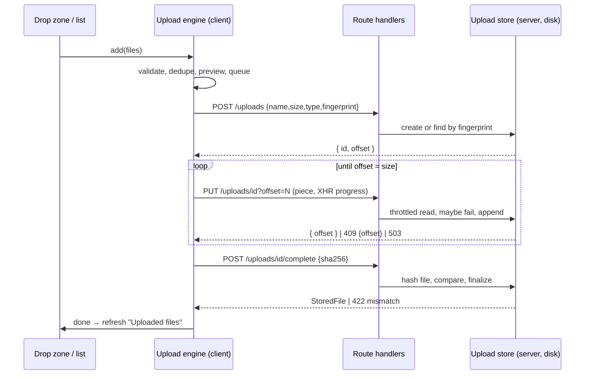

# Technical Design: File Upload with Progress

## Scope

**In scope:** a resumable upload backend in this repo (create/lookup an
upload, append pieces at a confirmed offset with a server-side speed throttle
and failure injection, complete with a checksum check, cancel/delete, list
stored files, demo settings, bounded temp storage); a hand-built client upload
engine (validation, fingerprinting, concurrency queue, per-piece transfer
with progress, retry with backoff, pause/resume/cancel, offline handling,
reload-interrupted records, checksum); the UI (drop zone with keyboard,
paste and folder drop, file rows with previews and two-tone progress, overall
progress, bulk actions, uploaded-files list); demo controls, the guide
(quick task 002 format) and the practice route.

**Out of scope:** everything in the spec's Out of Scope table; the shadcn
Progress component (the practiced pattern is built by hand, feature 001 rule).

## Research Summary

> Sources: bundled Next 16 docs (`03-file-conventions/route.md` "Request Body";
> `05-config/01-next-config-js/proxyClientMaxBodySize.md`; `serverActions.md`),
> MDN knowledge of the web platform (flagged where unverified).

- Route handlers read the body with standard Web APIs (`request.body` is a `ReadableStream`). There is no route-handler body limit; the 10 MB buffering limit applies only when a proxy file exists (none in this repo), and the 1 MB limit only to Server Actions. Pieces are at most 5 MB anyway.
- `fetch()` has no upload-progress events; `XMLHttpRequest.upload.onprogress` does. Pieces are sent with XHR (`PUT`, `application/octet-stream`, the `Blob.slice()` of the file).
- **Verified in T001:** reading `request.body` slowly in a Node route handler applies TCP backpressure. An 8 MB body read at a slow pace: the client's first ~2 MB went into socket buffers within 14 ms, after which its writes were paced by the server's reads. So the throttle genuinely slows the sender, but the first ~2 MB of any request are "sent" instantly from the browser's point of view.
- Folder drop uses `DataTransferItem.webkitGetAsEntry()` and `FileSystemDirectoryReader.readEntries()`, which returns entries in batches and must be called until it returns none; the entries must be collected synchronously inside the `drop` handler before the event ends. Paste uses `ClipboardEvent.clipboardData.files`.
- SHA-256: `crypto.subtle.digest("SHA-256", await file.arrayBuffer())` in the browser (≤ 50 MB by default, fine in memory); Node `crypto.createHash("sha256")` over the stored file on completion.

## Patterns & Reuse

### Conventions to Follow

| Pattern | Project Uses | Avoid | Reference |
|---------|-------------|-------|-----------|
| Route handlers | Thin: Zod-parse → store → `Response.json({ data })` / `jsonError` | Logic in routes | `src/app/api/practices/realtime-chat/messages/route.ts` |
| Long-lived server state | On `globalThis` so dev reloads and all route modules share it | Module state that duplicates on HMR | `src/server/practices/realtime-chat/chat.room.ts`, knowledge.md Decision (006) |
| Schemas | `*.schema.ts` without `server-only`, shared with the client | Duplicated types | `src/server/practices/realtime-chat/chat.schema.ts` |
| App-wide client store | Module-level store + `useSyncExternalStore`, constant server snapshot | Context/provider | `src/practices/realtime-chat/chat-store.ts` |
| Client API | Small wrappers throwing `Error(json.error.message)` | Fetching in components | `src/practices/realtime-chat/chat-api.ts` |
| Retry/backoff | `min(base·2ⁿ, cap) × jitter` | Fixed delays | `src/practices/realtime-chat/connection.ts` (`backoff`) |
| Practice page | Route renders `PracticeFrame`; `built: true` in the catalog; guide from `practice-guide.tsx` | Old free-form explanation | `src/app/(playground)/practices/realtime-chat/page.tsx`, knowledge.md Decision (quick 002) |
| Demo layout | `<DemoControls>` + `<DemoStage>`, local `Select`/`Range` helpers | Shared helper refactor | `src/practices/realtime-chat/demo.tsx` |
| Toasts | `toast` from the toast store | A second notifier | `src/practices/toast-notifications/toast-store.ts` |
| Scroll containers | `relative` when holding `sr-only`/absolute content | Escaping hidden text | knowledge.md Gotcha (quick 003) |
| Handlers | Inline only for one-line calls | Multi-line inline handlers | `.claude/rules/05-event-handlers.md` |

### Existing Code to Reuse

| Component | Location | How to Use |
|-----------|----------|------------|
| `jsonError`, `parseBody` | `src/lib/http.ts` | Errors and JSON bodies (pieces are raw bytes, read directly) |
| `toast` | `src/practices/toast-notifications/toast-store.ts` | Batch result toast when the queue drains |
| `PracticeFrame`, `DemoControls`, `DemoStage` | `src/components/playground/` | Page frame and demo layout |
| Guide blocks | `src/components/playground/practice-guide.tsx` | `Intro`, `KeyIdeas`, `ReadMore`, `GuideSection`, `DoAvoid`, `ControlGuide` |
| `Button` | `src/components/ui/button.tsx` | Actions |
| catalog entry | `src/practices/catalog.ts` (`slug: "file-upload"`) | Flip `built: true` |

## Data Model

### Entities

| Entity | Purpose |
|--------|---------|
| UploadSession (server) | One resumable upload: received bytes on disk + metadata |
| StoredFile (server) | A completed, verified upload |
| UploadSettings (server) | Demo-controlled speed, failure rate and rules the server enforces |
| UploadItem (client) | One file in the list, with status and progress |
| InterruptedRecord (client) | An unfinished upload remembered across reloads |

All entities are new (greenfield practice).

#### UploadSession / StoredFile (new, `src/server/practices/file-upload/upload.schema.ts`)

- `id` (string) -- upload id (uuid)
- `name` (string) -- original name, display only (≤ 255 chars)
- `path` (string | null) -- path inside a dropped folder, display only
- `size` (number) -- total bytes declared at creation
- `type` (string) -- MIME type ("" allowed; extension decides)
- `fingerprint` (string) -- `name|size|lastModified|type`, used to resume after reload
- `offset` (number) -- bytes received and stored so far (= confirmed)
- `status` ("uploading" | "complete")
- `sha256` (string | null) -- set on completion
- `createdAt`, `completedAt` (ISO strings)
- on disk: `<tmp>/react-practices-uploads/<id>.part`, renamed to `<id>.bin` when complete

#### UploadSettings (server, demo controls)

- `speedKBps` (number | null) -- null = unlimited
- `failRate` (0–1) -- share of pieces failed with 503
- `maxSizeMB` (number), `allowedKinds` (("image" | "pdf" | "text" | "zip")[]) -- re-checked at creation

#### UploadItem (client)

- `id` (string) -- client id; React key
- `file` (File | null) -- null for interrupted records until the file is re-added
- `name`, `path`, `size`, `type`, `fingerprint`
- `status` ("rejected" | "duplicate" | "queued" | "uploading" | "paused" | "waiting-network" | "verifying" | "done" | "failed" | "interrupted")
- `reason` (string | null) -- rejection or failure message
- `uploadId` (string | null), `confirmed` (bytes), `inFlight` (bytes of the current piece sent but not confirmed)
- `speed` (bytes/s, smoothed), `eta` (s | null), `attempt` (piece retry count)
- `previewUrl` (string | null) -- object URL for images
- `addedAt` (number) -- queue order

### Relationships

UploadItem 0..1 ─ 1 UploadSession (by `uploadId`); UploadSession → StoredFile on completion (same id). InterruptedRecord ↔ UploadItem matched by `fingerprint`.

### API Contracts

All under `/api/practices/file-upload`. Errors use `{ error: { message, issues? } }`.

| Endpoint | Method | Request | Response |
|----------|--------|---------|----------|
| `/uploads` | POST | `{ name, path?, size, type, fingerprint }` | `201 { data: { id, offset } }`; existing incomplete upload with the same fingerprint → `200 { data: { id, offset } }` (resume); 422 rule violation (type/size/empty) |
| `/uploads/[id]` | GET | – | `{ data: { id, offset, size, status } }`; 404 unknown (removed) |
| `/uploads/[id]` | PUT | query `offset`; body = raw bytes (≤ 5 MB) | `{ data: { offset } }`; `409 { error, offset }` when `offset` ≠ server offset (client resyncs); `503` simulated / temporary; 404 unknown; 413 piece too large or beyond `size` |
| `/uploads/[id]/complete` | POST | `{ sha256 }` | `{ data: StoredFile }`; `422` checksum mismatch (upload deleted); 409 not all bytes received |
| `/uploads/[id]` | DELETE | – | `204` (cancel an unfinished upload or delete a stored file) |
| `/files` | GET | – | `{ data: { files: StoredFile[] (newest first), usedBytes, limitBytes } }` |
| `/settings` | GET / PUT | `Partial<UploadSettings>` | `{ data: UploadSettings }` |

### Currently Exposed Fields

| AC ID | Field | Source (file:line) | Currently Exposed? | Gap? |
|-------|-------|--------------------|--------------------|------|
| AC-001 | name, size, type | none (new `UploadItem`) | no | must add |
| AC-007 | percentage, speed, time left | none (new `UploadItem.confirmed/speed/eta`) | no | must add |
| AC-009 | overall bytes / files | none (derived from items) | no | must add |
| AC-026 | name, size, upload time, verified match | none (new `StoredFile`) | no | must add |

## Decisions

| Decision | Rationale |
|----------|-----------|
| Hand-built offset protocol: create → `PUT ?offset=` pieces → complete with SHA-256; server is the source of truth for the offset | Same idea as resumable-upload standards, small enough to read in one sitting; a `409` with the server's offset makes retries after a lost response idempotent (SC2 "each confirmed piece exactly once") |
| Pieces sent with `XMLHttpRequest` (one per piece) | Only XHR exposes upload progress events; `abort()` gives immediate pause/cancel |
| Progress bar is two-tone: solid = confirmed by the server (the percentage text), light = sent in the current piece, not yet confirmed | Honest progress (Goal 2, AC-007): a failed piece only clears the light part, so the confirmed value never moves backwards |
| Speed = exponential moving average of **confirmed** bytes per second, updated on each confirmed piece (α ≈ 0.5); time left = (size − confirmed) / speed, hidden until the first piece is confirmed. Upload progress events only drive the light "in flight" part of the bar | T001: socket buffers absorb ~2 MB instantly, so sent-byte rates overstate speed early on; confirmed bytes are what the server really has (SC4) |
| Server throttle: read `request.body` chunk by chunk and sleep so the running average stays ≤ `speedKBps`; confirm only after the whole piece is written | Real backpressure (pending T001 check); confirmation reflects bytes actually stored |
| Failure injection: with probability `failRate`, read about half the piece, discard it, answer `503` | Realistic mid-transfer failure; nothing is appended, so resume starts at the same offset |
| Piece retry: up to 12 attempts per piece (at a 50% failure rate a piece fails for good with probability 0.5¹² ≈ 1/4096, so a 20-piece file fails ≈ 0.5% of the time; 4 attempts would fail it most of the time, 10 about 2%, which T013 hit once) with delays `min(500·2ⁿ, 8000) × (0.5–1)`; 503, network errors and timeouts (60 s) are temporary; 404/413/422 are permanent; 409 resyncs without counting as a failure | AC-013, AC-014, edge case "timeout" |
| Upload engine is a module-level store (`useSyncExternalStore`); uploads keep running when leaving the practice | decisions.md "Leaving the practice"; matches chat and toast |
| Scheduler: one `pump()` keeps `running ≤ concurrency`, picking queued items by `addedAt`; a shrink lets running items finish their current piece, then requeues them at the front | AC-006, AC-020, AC-021 |
| Pause = abort the XHR (the in-flight piece is lost, ≤ one piece re-sent) → `paused`; resume = `queued`, then `GET` the server offset before continuing. On the server a newer piece request for the same upload supersedes an abandoned one, and reading stops when the client disconnects | AC-015/016, SC3: without superseding, the server refused the resumed piece while still finishing the abandoned one, and the client paid for two pieces per pause |
| Cancel = abort + `DELETE`; the item leaves the active list | AC-017 |
| Offline (`navigator.onLine` false / `offline` event): abort in-flight pieces, mark `waiting-network` without spending retries; `online` requeues them | Edge case "offline" |
| Validation on add (types by MIME, falling back to the extension; size; empty; count) and again on the server at creation | AC-003; never trust the client |
| Duplicate = same fingerprint as an item still in the list (not rejected) | Edge case "same file twice" |
| Fingerprint `name|size|lastModified|type`; unfinished uploads saved in `localStorage` (`upload:interrupted`, ≤ 50) on every confirmed piece; on load they appear as `interrupted`; adding a file with the same fingerprint resumes via `POST /uploads` (server returns the existing id + offset) | AC-033/034 |
| Checksum: client SHA-256 computed when the last piece is confirmed (one file at a time, so several large files don't fill memory together); server SHA-256 of the stored file; mismatch → `failed` ("File changed during upload"), server copy deleted | AC-008, edge case "file changed" |
| Storage: `os.tmpdir()/react-practices-uploads`, emptied on the first request a server process handles (never on import: `next build` imports route modules in worker processes and would wipe a running server's files); after each completion, if total stored > 200 MB, delete the oldest stored files (then oldest stale partials) | decisions.md "Storage bound", AC-028 |
| Stored names: files saved as `<uuid>.part/.bin`; the original name is metadata only, rendered as text | Edge case "unusual names": no path traversal, no injection |
| Previews: `URL.createObjectURL` for `image/*` ≤ 20 MB, revoked when the item is removed or cleared | AC-022/023 |
| Folder drop: walk `webkitGetAsEntry()` recursively (looping `readEntries`), set `path` from `fullPath`; also supports pasting (`paste` on the practice root) and the picker (`multiple`) | AC-024/025 |
| Announcements: one hidden `role="status"`: summaries on add ("3 files added, 1 rejected"), on finish of each file, and at queue drain; progress bars are `role="progressbar"` with `aria-valuenow` (not live) | AC-005, AC-010 |
| Toast when the queue drains after a batch: "N files uploaded" / "N uploaded, M failed" | Spec Notes |
| Sample files generated in the browser: a PNG (canvas), a CSV, a JSON, a 20 MB `.zip` of random bytes, an empty file and an `.exe` (rejections) | AC-032 |
| UI direction (ui-ux-pro-max returned little for uploaders; built-in priorities applied): status is text + icon, never color alone; touch targets ≥ 44 px on phones; progress uses theme tokens (`bg-primary` confirmed, `bg-primary/30` in flight); no horizontal scroll at 360 px | Accessibility and layout priorities 1, 2, 5 |

## Component Design

| Component | File | Action | Responsibility |
|-----------|------|--------|----------------|
| Schemas | `src/server/practices/file-upload/upload.schema.ts` | new | Zod: create body, piece query, complete body, settings; kinds → MIME/extension table; shared types |
| Upload store (server) | `src/server/practices/file-upload/upload.store.ts` | new | `server-only`; `globalThis` state; temp dir lifecycle; create/lookup by fingerprint; append with throttle + failure injection; complete with SHA-256; delete; list; storage bound |
| Routes | `src/app/api/practices/file-upload/{uploads,uploads/[id],uploads/[id]/complete,files,settings}/route.ts` | new | Thin adapters |
| Client API | `src/practices/file-upload/upload-api.ts` | new | `createUpload`, `getUpload`, `sendPiece` (XHR with progress/abort/timeout), `completeUpload`, `deleteUpload`, `listFiles`, `get/putSettings` |
| Rules | `src/practices/file-upload/rules.ts` | new | Validate a file against current rules; kind detection by MIME/extension; fingerprint |
| Engine | `src/practices/file-upload/upload-store.ts` | new | Items, scheduler, per-file piece loop, retry, pause/resume/cancel/retry, offline, interrupted records, checksum, previews, announcements, batch toast; `useUploads()` |
| Collect files | `src/practices/file-upload/collect-files.ts` | new | From drop (`DataTransfer` incl. folders), paste and picker |
| Sample files | `src/practices/file-upload/sample-files.ts` | new | Generate demo files in the browser |
| Drop zone | `src/practices/file-upload/drop-zone.tsx` | new | Drag states, keyboard picker, rules text, paste target |
| File row | `src/practices/file-upload/file-row.tsx` | new | Preview/icon, name + path, size, status, two-tone bar, speed/ETA, actions |
| Upload list | `src/practices/file-upload/upload-list.tsx` | new | Overall progress, bulk actions, rows, interrupted section |
| Stored files | `src/practices/file-upload/stored-files.tsx` | new | "Uploaded files" list with delete and storage usage |
| Demo | `src/practices/file-upload/demo.tsx` | new | Controls (speed, piece failure, concurrency, piece size, max size, allowed types, max files, Add sample files) + stage |
| Guide | `src/practices/file-upload/explanation.tsx` | new | Guide format (quick 002) |
| Page | `src/app/(playground)/practices/file-upload/page.tsx` | new | `PracticeFrame` |
| Catalog | `src/practices/catalog.ts` | modify | `built: true` |

## Visual Design Considerations

- **Layout (≥ lg):** drop zone (dashed border, icon, "Drop files or a folder, paste, or choose files", rules line) → toolbar (overall bar "12.4 / 48.0 MB · 3 of 8 files", Pause all, Resume all, Cancel all, Clear finished) → file list → "Uploaded files" card. Below lg everything stacks; row actions wrap under the name.
- **Row:** 40 px thumbnail or kind icon; name (truncate, `title` with full name and path); size; status chip (icon + text: Queued #2, Uploading, Paused, Waiting for network, Verifying…, Done, Failed: reason, Rejected: reason, Duplicate, Interrupted); two-tone bar + "37% · 412 KB/s · 18 s left"; icon buttons with `aria-label` (Pause / Resume / Cancel / Retry / Remove).
- **Drag state:** border becomes `border-primary`, background `bg-primary/5`, text "Release to add files"; a counter of drag enters/leaves avoids flicker over child elements.
- **States:** empty list shows nothing below the drop zone except the stored-files card; interrupted records show "Add the same file again to resume" with a Forget button.
- **Motion:** bar width transitions 150 ms, disabled with reduced motion.

## Data Flow

## Requirements Traceability

| Requirement | Component | File | Status |
|-------------|-----------|------|--------|
| AC-001 name/size/type | Drop zone, Engine, File row | `drop-zone.tsx`, `upload-store.ts`, `file-row.tsx` | Planned |
| AC-002 | Drop zone | `drop-zone.tsx` | Planned |
| AC-003 | Rules, Engine; server re-check | `rules.ts`, `upload.store.ts` | Planned |
| AC-004 | Drop zone | `drop-zone.tsx` | Planned |
| AC-005 | Engine announcements | `upload-store.ts`, `upload-list.tsx` | Planned |
| AC-006 | Engine scheduler | `upload-store.ts` | Planned |
| AC-007 percentage/speed/ETA | Engine, File row | `upload-store.ts`, `file-row.tsx` | Planned |
| AC-008 | Engine checksum, complete route | `upload-store.ts`, `complete/route.ts`, `upload.store.ts` | Planned |
| AC-009 | Upload list overall progress | `upload-list.tsx` | Planned |
| AC-010 | File row progressbar | `file-row.tsx` | Planned |
| AC-011, AC-012 | Engine piece loop, PUT route | `upload-store.ts`, `uploads/[id]/route.ts` | Planned |
| AC-013, AC-014 | Engine retry rules | `upload-store.ts` | Planned |
| AC-015–AC-019 | Engine controls, Upload list bulk actions | `upload-store.ts`, `upload-list.tsx` | Planned |
| AC-020, AC-021 | Engine scheduler, File row queue position | `upload-store.ts`, `file-row.tsx` | Planned |
| AC-022, AC-023 | Engine previews | `upload-store.ts`, `file-row.tsx` | Planned |
| AC-024, AC-025 | Collect files | `collect-files.ts`, `drop-zone.tsx` | Planned |
| AC-026–AC-028 | Stored files, files route, store bound | `stored-files.tsx`, `files/route.ts`, `upload.store.ts` | Planned |
| AC-029, AC-030 | Settings route, store throttle/failure | `settings/route.ts`, `upload.store.ts` | Planned |
| AC-031 | Demo, Rules, Engine | `demo.tsx`, `rules.ts`, `upload-store.ts` | Planned |
| AC-032 | Sample files | `sample-files.ts`, `demo.tsx` | Planned |
| AC-033, AC-034 | Engine interrupted records | `upload-store.ts`, `upload-list.tsx` | Planned |
| Edge cases | Engine, Rules, Store | various | Planned |

## Test Strategy

### Infrastructure

| Aspect | Detail |
|--------|--------|
| Framework | No unit runner in the repo; same approach as features 002–006 |
| Command | `pnpm typecheck && pnpm lint && pnpm build`, then `pnpm start -p 3456` |
| Location | Scratch scripts in the session scratchpad (not committed) |

### Reference Tests

| File | What It Tests |
|------|---------------|
| `.artifacts/features/006-realtime-chat/tasks.md` (Verification Notes) | Pattern for curl + Node scripts + headless Chrome evidence |

### New Tests

| Component | Test File | Scenarios |
|-----------|-----------|-----------|
| Backend | scratch `curl` + Node script | create/resume by fingerprint, 409 resync, 503 injection appends nothing, throttle rate, 413/422, complete + checksum match/mismatch, delete, storage bound, settings |
| Throttle spike (T001) | scratch Node script with a slow server read | whether request bodies stream with backpressure in a route handler |
| UI | headless Chrome (single tab, see knowledge.md) | SC1–SC6, folder/paste via synthetic `DataTransfer`, reload-interrupted flow, 360 px, axe light + dark |

## Considerations

### Error Handling

- Temporary (503, network, timeout): per-piece retry with backoff, then `failed` with Retry (resumes from the server offset).
- Permanent (404 upload gone, 413, 422 rule or checksum): `failed` with the reason; Retry starts over with a new upload.
- 409 offset mismatch: adopt the server's offset and continue (no failure counted).
- Batch toast on drain; per-file reasons stay in the list.

### Security

- Server re-validates type (MIME or extension), size and piece bounds; ids are uuids validated by Zod; files are stored under generated names in a dedicated temp directory, never under the client's name or path.
- Original names are rendered as text; nothing uploaded is ever served back as content (the list shows metadata only).
- Disk use bounded to 200 MB plus at most one in-progress piece per upload; the directory is emptied on server start.

## Open Questions

- [x] Request-body backpressure in Node route handlers: confirmed by the T001 spike (see Research Summary); speed/ETA moved to confirmed bytes.
