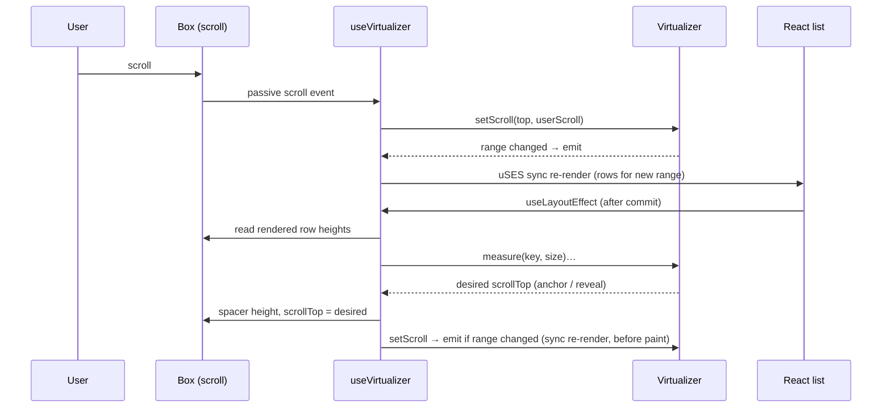

# Technical Design: Virtualized Large Lists

## Scope

**In scope:** a seeded in-browser ticket generator (chunked, cached, up to
100,000), view building (4 sort orders + accent-insensitive filter), a
framework-free virtualizer (Fenwick tree of row sizes, window + overscan,
anchor-based scroll correction, reveal targets, pinned active row), a React
binding hook, a naive list with the same keyboard model, the list box
(roving focus, selection, position-in-set), toolbar (filter, sort, jump),
detail panel, live stats + debug view, demo controls, explanation guide,
route and catalog entry.

**Out of scope:** server data, window scrolling, >100k rows (scroll-height
scaling), horizontal virtualization, multi-select, position restoration,
automated test framework (none exists in the repo).

## Research Summary

> Sources: WAI-ARIA APG Listbox pattern, MDN (ResizeObserver, scroll anchoring / `overflow-anchor`, `Element.focus({ preventScroll })`), React docs (`useSyncExternalStore`, `useLayoutEffect`, `useDeferredValue`), vercel-react-best-practices, ui-ux-pro-max.

- **APG Listbox (single select):** container `role="listbox"` + `aria-label`; children `role="option"` with `aria-selected`. Up/Down, Home/End move focus; Page Up/Down optional. Focus can be roving tabindex (one option `tabIndex=0`) or `aria-activedescendant`. With virtualization, options that aren't in the DOM can't be focused or referenced, so the active option must stay rendered. `aria-setsize`/`aria-posinset` on options tell assistive tech the full size when only some options exist.
- **Roving tabindex chosen over aria-activedescendant:** focus physically sits on the option, which VoiceOver/NVDA announce more reliably than activedescendant, and it makes "focus is never lost" a checkable DOM property (`document.activeElement` is the active row). Requires the active row to be pinned in the render.
- **Height correction without jumps:** keep an *anchor* (first visible row key + pixel offset into it). After any size change, set `scrollTop = offsetOf(anchor) + delta`. Doing this in `useLayoutEffect` (after DOM mutation, before paint) and re-rendering synchronously means the corrected frame is the first one painted. Browser scroll anchoring must be off (`overflow-anchor: none`) or it double-corrects.
- **Finding rows fast:** a Fenwick (binary indexed) tree over row sizes gives `offsetOf(i)` and `indexAt(px)` in O(log n) and a size update in O(log n); rebuild is O(n) on filter/sort. A plain prefix-sum array would need O(n) updates per measurement.
- **`useSyncExternalStore` updates are synchronous:** a store notification from a native scroll listener or a layout effect re-renders before paint, so the window keeps up with scrolling and corrections never flash.
- **ResizeObserver loop errors:** observing every row and re-rendering rows from the callback can trigger "ResizeObserver loop completed with undelivered notifications" (same-depth elements added during delivery). Avoided by measuring rows in the layout effect of every commit and observing only the scroll box (width/height); font loading is handled with `document.fonts` `loadingdone`.
- **vercel-react-best-practices:** passive scroll listener (`client-passive-event-listeners`), transient scroll values in the virtualizer not React state (`rerender-use-ref-transient-values`), `useDeferredValue` for the filter (`rerender-use-deferred-value`), memoized rows and lists (`rerender-memo`), lazy init of the virtualizer (`rerender-lazy-state-init`), `toSorted`/typed arrays (`js-tosorted-immutable`), position lookup array instead of `indexOf` (`js-index-maps`).
- **ui-ux-pro-max:** visible focus rings (≥3:1), empty state with an action ("Clear filter"), no horizontal scroll at 360 px, errors next to the field (jump input), reduced motion. Its "smooth scroll" rule is not applied to programmatic jumps: smooth scrolling through estimated rows lands in the wrong place while heights correct, so all programmatic scrolling is instant (spec edge case). Its "virtualize lists over 100 items" rule is the practice itself.

## Patterns & Reuse

### Conventions to Follow

| Pattern | Project Uses | Avoid | Reference |
|---------|-------------|-------|-----------|
| Practice registration | Own route + `built: true` in catalog | Touching `[slug]` | src/app/(playground)/practices/infinite-scroll/page.tsx:1 |
| Demo layout | `DemoControls` + `DemoStage`, local `Range`/`Select` helpers | New control library | src/practices/infinite-scroll/demo.tsx:71 |
| Client module store | Module-level state + `useSyncExternalStore`, constant server snapshot | Context provider | src/practices/toast-notifications/toast-store.ts:5 |
| Scroll box | `h-[32rem] overflow-y-auto overscroll-contain rounded-lg border`, `relative` (sr-only gotcha) | Unpositioned scroller | src/practices/infinite-scroll/feed-view.tsx:178 |
| Live region | `role="status"` `sr-only` paragraph written via `textContent` in an effect | setState for announcements | src/practices/infinite-scroll/feed-view.tsx:126 |
| JSX handlers | Named `handleX` unless a one-line call | Multi-line inline handlers | .claude/rules/05-event-handlers.md |
| Guide | `Intro`, `KeyIdeas`, `ReadMore`, `GuideSection`, `DoAvoid`, `ControlGuide` | Free-form explanation | src/components/playground/practice-guide.tsx:1 |
| Focus ring contrast | Strong token (`outline-primary`), not `ring-ring/50` (≈2:1 in light) | Default ring on new surfaces | .agents/knowledge.md (ring gotcha) |

### Existing Code to Reuse

| Component | Location | How to Use |
|-----------|----------|------------|
| Button, Input, Skeleton | src/components/ui/* | Toolbar, jump, empty state, generating placeholder |
| `DemoControls`, `DemoStage` | src/components/playground/demo-controls.tsx:5, demo-stage.tsx:34 | Practice layout |
| `toast` | src/practices/toast-notifications/toast-store.ts | Announce the forced switch back to virtualized (AC-016) |
| Practice guide blocks | src/components/playground/practice-guide.tsx | Explanation |
| `practiceMetadata`, `getPractice` | src/practices/catalog.ts | Route metadata |

The accent folding in `searchable-accordion/search.ts` keeps an index map for highlighting; this practice has no highlighting, so it folds whole strings once (`normalize("NFD")`, strip marks, lowercase), which is cheaper.

## Data Model

### Entities

| Entity | Purpose |
|--------|---------|
| Ticket | One generated row |
| View | The current ordered, filtered list of ticket keys |
| Virtualizer snapshot | What the virtual list renders |
| List stats | Live numbers shown above the list |

All new, client-only.

#### Ticket (`src/practices/virtualized-list/tickets.ts`)

- `key` (number) -- 0-based index in the generated universe; stable identity for sizes, active and selected
- `id` (number) -- `key + 1`, shown as "#12,345"
- `title` (string, 4–9 words)
- `body` (string, 0–4 sentences: the source of variable height)
- `requester` (string; some names have accents, e.g. "José Núñez", so accent-insensitive search is observable)
- `priority` (0 urgent · 1 high · 2 normal · 3 low)
- `status` ("open" | "pending" | "solved")
- `createdAt` (number, ms; increases with `id`, so "newest" = highest id)

Content comes from `mulberry32(SEED ^ hash(key))`, so ticket N is identical whatever size or chunk produced it (AC-007). A parallel `folded: string[]` holds the folded `title + body + requester` for filtering.

#### View (`src/practices/virtualized-list/view.ts`)

- `keys` (Int32Array) -- ticket keys in display order
- `total` (number) -- tickets generated (M in "N of M")

Base orders per (sort, count) cached in a module Map: oldest = identity; newest = reversed; priority = bucket by priority, newest first inside a bucket (O(n)); title = sort by folded title then id. The filter splits the folded query into words and keeps keys whose folded text contains every word.

#### Virtualizer snapshot (`src/practices/virtualized-list/virtualizer.ts`)

- `rows` ({ index, key, offset, size, measured, overscan }[]) -- rows to render, including the pinned row
- `total` (number, px) -- spacer height
- `visibleStart`, `visibleEnd` (number) -- rows intersecting the viewport
- `measured` (number) -- keys with a measured size

#### List stats (`src/practices/virtualized-list/list-stats.ts`)

- `onPage` (number), `inList` (number), `visibleStart`/`visibleEnd` (number | null), `lastUpdateMs` (number | null), `cause` ("mode" | "rows" | "filter" | "sort" | "scroll" | "settings"), `measured` (number | null, virtual only)

### Relationships

A View references Tickets by key. The virtualizer stores measured sizes by ticket key (not position), so sizes survive filter and sort; the Fenwick tree is rebuilt in view order from those sizes.

### API Contracts

None: no network.

### Currently Exposed Fields

| AC ID | Field | Source (file:line) | Currently Exposed? | Gap? |
|-------|-------|--------------------|--------------------|------|
| AC-015 | rows on page | none | no | must add (list stats) |
| AC-015 | rows in list | none | no | must add |
| AC-015 | visible row range | none | no | must add |
| AC-015 | last render time | none | no | must add |
| AC-027 | rows measured | none | no | must add |

## Decisions

| Decision | Rationale |
|----------|-----------|
| Framework-free `Virtualizer` class + thin `useVirtualizer` hook | The algorithm (sizes, window, anchor, reveal) is the practice; keeping it out of React makes it readable and checkable with a plain script |
| Fenwick tree over sizes in view order; sizes stored by key | O(log n) offset/index/update at 100k; reorder needs only an O(n) rebuild |
| Rows absolutely positioned with `transform: translateY(offset)` inside a spacer of `total` px | Rows never push each other, so an estimate error moves only our numbers, not the layout; transforms are cheap |
| Anchor-based correction in `useLayoutEffect`, then a synchronous store notification | First painted frame is already corrected (AC-005, AC-006, AC-019); `overflow-anchor: none` on the box |
| Reveal targets (`start`, `nearest`, `offset`) persist until the user scrolls | A jump or arrow key lands correctly even when the target's own height (or rows above it) is corrected after it renders (AC-010, AC-018, AC-019) |
| Programmatic vs user scroll told apart by the last `scrollTop` we set (±1 px) | Our own scroll events must not cancel a reveal target |
| Measure rendered rows in every commit; observe only the box; re-sync on `document.fonts` `loadingdone` | Catches all height changes without ResizeObserver loop errors |
| Width change clears measured sizes, keeps the anchor | Wrapping changes every height; rendered rows re-measure in the same frame, the rest re-measure when shown |
| Roving tabindex; active row pinned in the render; focus moved in a layout effect with `preventScroll` | Focus never lands on a missing row; we control scrolling (AC-012, success criterion "holding Down") |
| `active` and `selected` are ticket keys lifted to the browser component | Survive filter, sort and mode switch |
| Naive list shares row, keyboard model and stats; its layout reads the DOM (`children[i].offsetTop`) | Comparison isolates rendering cost only (AC-014) |
| Mode switch passes `{ key, delta }` of the top row to the new list | Keeps the first visible row (AC-017) |
| Row count change remounts the list (key = count) and clears active/selected | "Return to the top" by construction (AC-007) |
| Filter through `useDeferredValue`; list components memoized | Typing stays responsive; urgent renders skip the list (AC-021) |
| Generation in 5,000-ticket chunks on `setTimeout(0)`, appended to a module cache | 100k never blocks the main thread in one task; growing the size reuses earlier tickets |
| "Last update" timing = from the triggering event to after layout in the list's layout effect | `Profiler` doesn't report in production builds; this is honest and includes DOM + layout cost, which is what naive mode pays |
| Default estimated height = 96 px (spec said 72) | Closer to the real average (~100 px), so the default shows small corrections; 40–200 px stays adjustable. Spec AC-028 updated |
| Stats in their own tiny store + component | Stat updates don't re-render the list |
| Row meta and body text use `text-foreground/75`, not `text-muted-foreground` | Muted text failed 4.5:1 in light mode on the selected (`bg-accent`) and debug-tinted rows |
| Focus style: `outline-2 outline-primary -outline-offset-2`; selected: `bg-accent` + 3 px primary left bar + check icon | ≥3:1 in both themes (shadcn ring is ≈2:1 in light) and selection isn't conveyed by color alone |

## Component Design

| Component | File | Action | Responsibility |
|-----------|------|--------|----------------|
| Route | src/app/(playground)/practices/virtualized-list/page.tsx | new | `PracticeFrame` with explanation + demo |
| Catalog | src/practices/catalog.ts | modify | `built: true` for virtualized-list |
| Ticket generator + store | src/practices/virtualized-list/tickets.ts | new | Seeded PRNG, word lists, `generate(key)`, chunked `ensure(count)`, `useTicketCount()` |
| View builder | src/practices/virtualized-list/view.ts | new | Sort orders (cached), folded query parsing, filter → `Int32Array` |
| Fenwick tree | src/practices/virtualized-list/fenwick.ts | new | `build`, `add`, `prefix`, `indexAt` |
| Virtualizer | src/practices/virtualized-list/virtualizer.ts | new | Sizes by key, keys/positions, window + overscan + pinned, anchor capture/restore, reveal targets, snapshot + subscribe |
| `useVirtualizer` | src/practices/virtualized-list/use-virtualizer.ts | new | Applies keys (with keep-place) and settings in layout effects, box listeners (passive scroll, ResizeObserver, fonts), per-commit sync (measure → correct → notify), exposes layout API |
| List layout API + keyboard | src/practices/virtualized-list/list-navigation.ts | new | `ListLayout`/`ListApi`/`SharedAnchor` types, `indexIn`, `tabStop`, `useFocusRow`, `useListNavigation` (keydown/focus/click), shared box class |
| Row | src/practices/virtualized-list/ticket-row.tsx | new | Memoized option: meta, title, body, selected/active styles, debug label |
| Virtual list | src/practices/virtualized-list/virtual-list.tsx | new | Listbox box + spacer + windowed rows |
| Naive list | src/practices/virtualized-list/naive-list.tsx | new | Listbox box with all rows in flow; DOM-based layout API; visible range on scroll |
| Stats store + bar | src/practices/virtualized-list/list-stats.ts, stats-bar.tsx | new | Update clock (`markUpdate`), stats snapshot, mono stats line |
| Toolbar | src/practices/virtualized-list/toolbar.tsx | new | Filter input + count, sort select, jump form with validation |
| Details | src/practices/virtualized-list/ticket-details.tsx | new | Selected ticket panel; "not in the current filter" |
| Browser | src/practices/virtualized-list/ticket-browser.tsx | new | Owns query/sort/active/selected; builds view; picks list by mode; empty + generating states; live region |
| Demo | src/practices/virtualized-list/demo.tsx | new | Controls (rows, mode, overscan, estimate, debug) + stage |
| Explanation | src/practices/virtualized-list/explanation.tsx | new | Guide |

### Layout (ui-ux-pro-max direction)

- Stage: toolbar row (filter grows; sort; jump) wraps on narrow screens → stats line (mono, `tabular-nums`, `text-xs`) → `lg:grid-cols-[minmax(0,1fr)_18rem]` with the list box (`h-[32rem]`, `h-[28rem]` below `sm`) and the detail panel (stacked below on small screens).
- Row: `px-4 py-3 border-b`; meta line (`#12,345` mono, priority pill with icon + text, status, requester, date) in `text-xs text-muted-foreground`; title `text-sm font-medium`; body `text-sm text-foreground/75` (not muted-on-muted).
- Debug view: visible rows tinted `bg-info/5`, overscan rows `bg-warning/10`; an in-flow first line "row 1,204 · 112 px measured" / "96 px est." in mono (an overlaid corner label covered the meta line at 360 px; in flow it also shows that a height change keeps the top row in place).
- Generating state: skeleton rows + "Generating tickets… 45%" with `aria-busy`. Empty state: "No tickets match “…”" + Clear filter button.
- Controls: Rows select; Mode as a two-button segmented group (`aria-pressed`), naive disabled with reason text above 20k; Overscan range; Estimated height range; Debug checkbox.

## Data Flow

1. `tickets.ensure(count)` generates in chunks → `useTicketCount()` updates.
2. Browser builds the view from (count, sort, deferred query) in `useMemo`.
3. List receives `keys`; on change its layout effect captures the keep-place target from the old keys, calls `setKeys`, then reveals that key at the same distance (or scrolls to top).
4. Keyboard handler computes the next key, calls `layout.reveal(key, "nearest")` + `onActiveChange(key)`; a layout effect focuses the active row with `preventScroll`.

## Requirements Traceability

| Requirement | Component | File | Status |
|-------------|-----------|------|--------|
| AC-001 | Browser, Virtual list | ticket-browser.tsx, virtual-list.tsx | Done |
| AC-002 | Virtualizer window + pinned | virtualizer.ts | Done |
| AC-003 | Passive scroll → sync render | use-virtualizer.ts | Done |
| AC-004 | Estimate / measure | virtualizer.ts, use-virtualizer.ts | Done |
| AC-005 | Anchor correction | virtualizer.ts, use-virtualizer.ts | Done |
| AC-006 | Box RO + clear sizes | use-virtualizer.ts | Done |
| AC-007 | Seeded generator; list keyed by count | tickets.ts, demo.tsx | Done |
| AC-008 | Listbox + options + posinset/setsize | virtual-list.tsx, naive-list.tsx, ticket-row.tsx | Done |
| AC-009 | onFocus → active + reveal | list-navigation.ts | Done |
| AC-010 | Key handling + reveal nearest | list-navigation.ts, virtualizer.ts | Done |
| AC-011 | Select + details | list-navigation.ts, ticket-details.tsx | Done |
| AC-012 | Pinned active row | virtualizer.ts | Done |
| AC-013 | Focus/selected styles | ticket-row.tsx | Done |
| AC-014 | Naive list | naive-list.tsx | Done |
| AC-015 | rows on page | list-stats.ts, stats-bar.tsx | Done |
| AC-015 | rows in list | list-stats.ts, stats-bar.tsx | Done |
| AC-015 | visible range | list-stats.ts, stats-bar.tsx | Done |
| AC-015 | last render time | list-stats.ts, stats-bar.tsx | Done |
| AC-016 | Naive limit + forced switch | demo.tsx | Done |
| AC-017 | Anchor handoff on mode switch | ticket-browser.tsx, both lists | Done |
| AC-018 | Jump form + reveal start | toolbar.tsx, virtualizer.ts | Done |
| AC-019 | Persistent reveal target | virtualizer.ts | Done |
| AC-020 | Jump validation | toolbar.tsx | Done |
| AC-021 | Deferred filter | view.ts, ticket-browser.tsx | Done |
| AC-022 | Sort orders | view.ts, toolbar.tsx | Done |
| AC-023 | Keep place on view change | virtual-list.tsx, naive-list.tsx | Done |
| AC-024 | Empty state | ticket-browser.tsx | Done |
| AC-025 | Match announcement | ticket-browser.tsx | Done |
| AC-026 | Overscan setting | virtualizer.ts, demo.tsx | Done |
| AC-027 | Debug view + rows measured | ticket-row.tsx, stats-bar.tsx | Done |
| AC-028 | Estimate setting | virtualizer.ts, demo.tsx | Done |

## Test Strategy

### Infrastructure

| Aspect | Detail |
|--------|--------|
| Framework | None in repo; quality gate `pnpm typecheck && pnpm lint && pnpm build` |
| Logic checks | Plain Node script in the scratchpad (`node --experimental-strip-types`) exercising `fenwick.ts`, `virtualizer.ts`, `view.ts` |
| UI checks | Puppeteer MCP against `pnpm build && pnpm start` on a spare port: scripted scroll, keys, jumps, DOM counts, long-task observer, axe in both themes, 360 px layout |

### Reference Tests

| File | What It Tests |
|------|---------------|
| .artifacts/features/004-infinite-scroll/tasks.md | Prior browser-verification approach (DOM counts, long tasks, axe) |

### New Tests

| Component | Test File | Scenarios |
|-----------|-----------|-----------|
| Fenwick / Virtualizer / View | scratchpad script (not committed) | prefix/indexAt vs naive sums on random sizes; window bounds; anchor restore after measuring rows above; reveal start/nearest/offset; keys rebuild keeps sizes; sort orders; filter folding |
| UI | Puppeteer evaluate scripts | DOM row bound during scroll; 10 random jumps within 1 px; hold Down to 300; mode switch keeps top row; filter keeps selected row distance; naive vs virtual timings; axe light/dark; 360 px no horizontal scroll |

## Considerations

### Error Handling

- The demo is wrapped in `DemoStage`'s error boundary; nothing here does I/O.
- Sync loop guard: at most 8 measure/correct passes per frame; if not converged, the next scroll or commit continues (prevents an infinite render loop if a row's height depends on its position).
- Jump input errors are inline next to the field (`aria-invalid`, `aria-describedby`).

### Security

- No user content leaves the browser; filter text is only compared, never rendered as HTML.

## Open Questions

- None.
