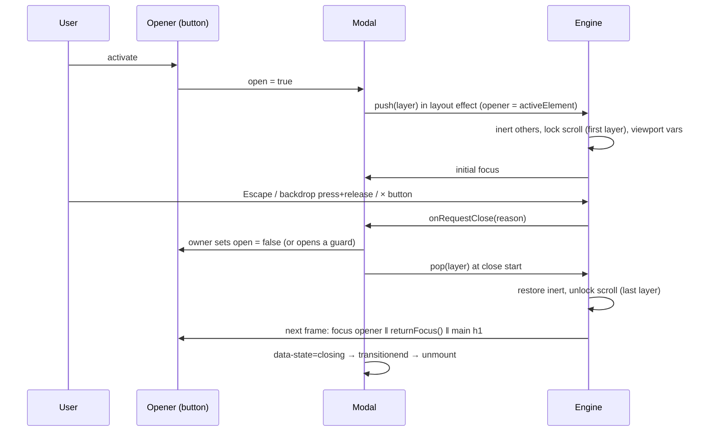

# Technical Design: Accessible Modal

## Scope

**In scope:** a modal engine (layer stack, inert background with kept
regions, scroll lock without shift, focus trap + focus guard, initial focus,
focus return with fallback, Escape, backdrop press-and-release, visual
viewport tracking, event emitter), a declarative `<Modal>` component
(portal, backdrop, open/close animation, dialog/sheet layouts), an app-wide
store (settings, `confirm()` requests, event log) with a `<ModalHost />`
mounted in the playground layout, the demo scenarios (projects + delete
confirm, edit profile with discard guard, three-level stacked settings,
long terms document, native `<dialog>` comparison), event log, demo
controls, explanation guide, route and catalog entry.

**Out of scope:** non-modal dialogs, drag/resize, swipe-to-dismiss, URL
routing of dialogs, retrofitting earlier practices, automated tests (no
framework in the repo).

## Research Summary

> Sources: WAI-ARIA APG Dialog (Modal) and Alert Dialog patterns; MDN `<dialog>`, `HTMLDialogElement.showModal()` / `requestClose()`, `inert`, `scrollbar-gutter`, `VisualViewport`; Tailwind v4 `starting:` variant; vercel-react-best-practices; ui-ux-pro-max.

- **APG modal dialog:** `role="dialog"` (or `alertdialog`), `aria-modal="true"`, `aria-labelledby` → title, `aria-describedby` → description. Initial focus: a sensible element (least destructive for alert dialogs; a static top element, `tabindex="-1"`, for long content). Tab/Shift+Tab wrap inside. Escape closes. On close, focus returns to the invoking element, or to a logical element when it no longer exists.
- **`inert`:** makes a subtree unfocusable, unclickable and removed from the accessibility tree; supported in all current engines. With the background inert, Tab from the last dialog control moves to the browser chrome, so wrapping still has to be done by hand (APG), and `aria-modal` alone is not enough for every screen reader.
- **Inert everything but the kept elements:** walk from `<body>` down; any child that neither is nor contains a kept element (top dialog layer, toaster) gets `inert`; children that contain one are descended into. Only attributes we set are removed later. Lower dialogs are siblings in the modal root, so they become inert too (AC-016).
- **Scroll lock without shift:** `overflow: hidden` on `<html>` removes the classic scrollbar and shifts content. Setting `scrollbar-gutter: stable` at the same time keeps the gutter, so nothing moves; only applied when a classic scrollbar is present (`innerWidth > clientWidth`), otherwise it would add a gutter. The page scrolls on the window here (`SidebarInset` is a normal-flow `main`).
- **Native `<dialog>.showModal()`:** top layer, everything else inert (including toasts), Escape fires `cancel`, initial focus on the first focusable, focus returns to the previously focused element on close; it does not lock page scroll, and backdrop light-dismiss depends on the newer `closedby` attribute (feature-detected at runtime, not assumed). Exit animations need extra work. `requestClose()` routes through `cancel` (MDN).
- **Backdrop clicks:** close only when both `pointerdown` and `pointerup` happened on the backdrop, so a text selection that starts inside and ends outside doesn't dismiss.
- **On-screen keyboard:** `dvh` doesn't shrink for the iOS keyboard; `visualViewport` height/offset is copied into CSS variables on the modal root while a dialog is open, and the sheet uses them for max height and bottom offset.
- **Enter animation without a JS frame:** Tailwind v4 `starting:` (`@starting-style`) with transitions; exit uses `data-state="closing"` + `transitionend` (with a 250 ms timeout fallback).
- **vercel-react-best-practices:** module-level store + `useSyncExternalStore` (like the toaster), handlers in refs for document listeners (`advanced-event-handler-refs`), `useEffectEvent` for listeners that read props, no setState in effects, conditional rendering with ternaries.
- **ui-ux-pro-max:** focus states visible (≥3:1), destructive action styled `destructive` and never the default focus, errors next to fields with focus to the first invalid, 150–200 ms ease-out enter / faster exit, `prefers-reduced-motion`, bottom sheet on phones with safe-area padding, touch targets ≥ 44 px in the sheet, no horizontal scroll.

## Patterns & Reuse

### Conventions to Follow

| Pattern | Project Uses | Avoid | Reference |
|---------|-------------|-------|-----------|
| App-wide client service | Module store + `useSyncExternalStore`, host mounted once in the playground layout | Context provider around the app | src/practices/toast-notifications/toast-store.ts:5, src/app/(playground)/layout.tsx:16 |
| Practice registration | Own route + `built: true` | Touching `[slug]` | src/app/(playground)/practices/virtualized-list/page.tsx:1 |
| Demo layout | `DemoControls` + `DemoStage`, local `Select` helpers | New control library | src/practices/virtualized-list/demo.tsx |
| Notifications | `toast` from the toast store | Inline status text for results | src/practices/toast-notifications/toast-store.ts:317 |
| No shadcn version of the practiced pattern | Hand-built dialog; Button/Input/Textarea allowed | `sheet.tsx` / Base UI Dialog | .agents/knowledge.md (feature 001 decision) |
| JSX handlers | Named `handleX` unless one-line | Multi-line inline handlers | .claude/rules/05-event-handlers.md |
| Guide | `practice-guide.tsx` blocks | Free-form text | src/components/playground/practice-guide.tsx |
| Text on tinted surfaces | `text-foreground/75` | `text-muted-foreground` on `bg-muted`/`bg-accent` | .agents/knowledge.md (light-mode contrast gotcha) |

### Existing Code to Reuse

| Component | Location | How to Use |
|-----------|----------|------------|
| Button, Input, Textarea | src/components/ui/* | Dialog actions, form fields |
| `toast` | src/practices/toast-notifications/toast-store.ts:317 | "Project deleted", "Profile saved" |
| Toaster | src/practices/toast-notifications/toaster.tsx:145 | Gets `data-modal-keep` so it stays reachable (minimal edit) |
| `DemoControls`, `DemoStage`, guide blocks | src/components/playground/* | Practice layout |

## Data Model

### Entities

| Entity | Purpose |
|--------|---------|
| Layer | One open dialog in the engine's stack |
| ModalSettings | Demo-controlled defaults |
| ConfirmRequest | A pending `confirm()` |
| ModalEvent | One log entry |

All new, client-only.

#### Layer (`src/practices/accessible-modal/modal-engine.ts`)

- `id` (string), `root` (HTMLElement: the layer element holding backdrop + dialog), `dialog` (HTMLElement), `opener` (HTMLElement | null, `document.activeElement` at open), `returnFocus` (() => HTMLElement | null, optional fallback), `onRequestClose` ((reason) => void), `backdropDismiss` (boolean), `lastFocused` (HTMLElement | null, for the focus guard)

#### ModalSettings (`modal-store.ts`)

- `backdropCloses` (boolean, default true), `animations` (boolean, default true), `layout` ("auto" | "dialog" | "sheet", default "auto")

#### ConfirmRequest (`modal-store.ts`)

- `id`, `title`, `description`, `confirmLabel` (default "Confirm"), `cancelLabel` (default "Cancel"), `destructive` (boolean), `returnFocus?`, `resolve(result: boolean)`

#### ModalEvent (`modal-store.ts`)

- `id` (number), `at` (ms), `type` ("open" | "close" | "blocked"), `title` (string), `detail` (string: "focus → Cancel", "Escape · focus returned to Delete project", "backdrop ignored (alert dialog)")

### Relationships

Layers form a stack (top = last). Each `<Modal>` instance owns one layer while open; `confirm()` requests render as `<Modal role="alertdialog">` inside `<ModalHost />`.

### API Contracts

None (no network). Public client API:

- `<Modal open onRequestClose(reason) title description? role? initialFocus? returnFocus? backdropDismiss? footer? showClose? size?>` — controlled; `reason` ∈ "escape" | "backdrop" | "close-button" | "navigation"
- `confirm(options): Promise<boolean>`
- `modalStore.settings` / `setSettings`, `useModalSettings()`, `useModalLog()`, `modalLog.clear()`

### Currently Exposed Fields

| AC ID | Field | Source (file:line) | Currently Exposed? | Gap? |
|-------|-------|--------------------|--------------------|------|
| AC-026 | event type / title / reason / focus target | none | no | must add (ModalEvent) |

## Decisions

| Decision | Rationale |
|----------|-----------|
| Framework-free engine module + thin React `<Modal>` | Stack, inert, scroll lock and focus rules are the practice; readable without React noise; one engine shared by declarative modals and `confirm()` |
| Controlled `<Modal open onRequestClose(reason)>` | The owner decides whether a close is allowed (unsaved changes, alert dialogs), like native `cancel` |
| Portal into a lazily created `#modal-root` (z-40) at the end of `<body>` | Escapes stacking contexts; siblings of the app shell, so inert-ing is simple; toaster (z-50) stays above the backdrop |
| Inert by tree walk with kept elements (`data-modal-keep`), recomputed on every push/pop, only removing what we set | Background and lower dialogs unreachable (AC-004, AC-016); toasts stay usable (AC-023) |
| Scroll lock on first push: `overflow: hidden` + `scrollbar-gutter: stable` (when a classic scrollbar exists) on `<html>`; restore on last pop | 0 px shift, scroll position untouched (AC-005) |
| Tab wrap via a capture `keydown` listener on `document` for the top layer; `focusin` guard returns focus to the layer's last focused element unless focus went to a kept region | APG wrapping despite inert; scripts/AT moving focus out are corrected; F8 toasts still work |
| Escape handled on `document` only when the event target is inside the top layer or is `<body>`, and not during IME composition | Closes the top dialog only (AC-006); toast Escape handling unaffected |
| Focus return scheduled one frame after close starts, resolving opener → `returnFocus()` → `main h1` (given `tabindex=-1`) | Callers can remove the opener (delete) before focus returns; never the body (AC-007) |
| Close starts by popping the layer (inert/scroll restored, focus returned), then the element animates out with `inert` on itself, then unmounts | Focus returns immediately; the exiting dialog can't be interacted with |
| Enter: `starting:` styles + transitions; exit: `data-state=closing`, wait `transitionend` on the dialog or 250 ms; no animation when reduced motion or setting off | AC-020/021 with no extra frame on open |
| Layout classes: dialog by default, sheet under `max-sm:` for "auto", always for "sheet" | One component, CSS-driven switch on resize (edge case) |
| `visualViewport` → `--modal-vh` / `--modal-kb` CSS vars on `#modal-root` while any layer is open | Sheet fits above the on-screen keyboard (AC-022) |
| Double-open guard: openers ignore activation while their dialog is open; `confirm()` is idempotent per call | One dialog for a double-click (edge case) |
| `<ModalHost />` cancels pending confirms on pathname change; `<Modal>` unmount pops its layer without returning focus | AC-024 |
| Native comparison in its own component using `showModal()`, `cancel`/`close` events, `closedby` only when `"closedBy" in HTMLDialogElement.prototype` | Honest comparison, no assumed support |
| Settings live in the shared store (demo controls write them) | Like toaster settings; any dialog opened anywhere uses them (AC-027) |
| Default initial focus skips the × button (`data-modal-close`) | It is first in the DOM but the least useful start; forms start on their first field (AC-002) |
| Layout resolved in JS from a `matchMedia` subscription, not duplicated `max-sm:` classes | One class set per layout; still switches live on resize |
| Destructive buttons in dialogs add `DESTRUCTIVE_TEXT` (token `color-mix`, darker in light mode) | The shadcn destructive variant is 4.1:1 in light mode; `ui/` is CLI-owned |

## Component Design

| Component | File | Action | Responsibility |
|-----------|------|--------|----------------|
| Engine | src/practices/accessible-modal/modal-engine.ts | new | Layer stack, inert walk, scroll lock, tabbables, trap/guard, Escape/backdrop routing, focus return, visual viewport vars, `describe(el)` |
| Store | src/practices/accessible-modal/modal-store.ts | new | Settings, confirm requests + `confirm()`, event log (+ hooks) |
| Modal | src/practices/accessible-modal/modal.tsx | new | Portal, backdrop, dialog markup + ARIA, close button, animation phases, layout classes, registers layer |
| Host | src/practices/accessible-modal/modal-host.tsx | new | Renders confirm requests; cancels on navigation |
| Layout | src/app/(playground)/layout.tsx | modify | Mount `<ModalHost />` |
| Toaster | src/practices/toast-notifications/toaster.tsx | modify | `data-modal-keep` on the root section |
| Projects scenario | src/practices/accessible-modal/projects-scenario.tsx | new | Project rows, delete via `confirm()`, fallback focus, New/Reset |
| Edit profile | src/practices/accessible-modal/edit-profile-dialog.tsx | new | Form, validation, dirty tracking, discard guard (nested `<Modal role="alertdialog">`) |
| Settings stack | src/practices/accessible-modal/settings-scenario.tsx | new | Settings → Advanced → "Reset all settings?" confirm (3 levels) |
| Terms | src/practices/accessible-modal/terms-scenario.tsx | new | Long document, focus on title, scrollable body (labelled, focusable region) |
| Native confirm | src/practices/accessible-modal/native-confirm.tsx | new | `<dialog>` + `showModal()` version of the delete confirm, logs events |
| Event log | src/practices/accessible-modal/event-log.tsx | new | Newest-first list + Clear |
| Demo | src/practices/accessible-modal/demo.tsx | new | Controls (backdrop, animations, layout) + scenario cards + log |
| Explanation | src/practices/accessible-modal/explanation.tsx | new | Guide |
| Route + catalog | src/app/(playground)/practices/accessible-modal/page.tsx, src/practices/catalog.ts | new / modify | Page; `built: true` |

### Visual direction (ui-ux-pro-max)

- Backdrop `bg-black/50` (+ `backdrop-blur-[2px]` when supported); dialog `bg-popover text-popover-foreground rounded-xl border shadow-lg`, widths `max-w-md` (confirm), `max-w-lg` (form), `max-w-2xl` (terms); `max-h-[min(85dvh,var(--modal-vh))]`, flex column: header (title `text-lg font-semibold`, description `text-sm text-foreground/75`, × button top-right 32 px), scrollable body (`overflow-y-auto overscroll-contain`), footer (actions right-aligned; stacked full-width on the sheet, 44 px tall).
- Enter: opacity 0 → 1, scale 0.96 → 1, 180 ms ease-out; exit 120 ms ease-in. Sheet: translate-y 100% → 0, 220 ms; `pb-[env(safe-area-inset-bottom)]`.
- Demo stage: 2-column grid of scenario cards (title, one-line purpose, opener button) on `md+`, single column on phones; event log below as a mono list with a Clear button.

## Data Flow

## Requirements Traceability

| Requirement | Component | File | Status |
|-------------|-----------|------|--------|
| AC-001 | Modal markup + engine push | modal.tsx, modal-engine.ts | Done |
| AC-002 | Initial focus resolution | modal-engine.ts | Done |
| AC-003 | Tab wrap + focus guard | modal-engine.ts | Done |
| AC-004 | Inert walk + scroll lock | modal-engine.ts | Done |
| AC-005 | Scrollbar gutter | modal-engine.ts | Done |
| AC-006 | Escape routing | modal-engine.ts | Done |
| AC-007 | Focus return chain | modal-engine.ts | Done |
| AC-008 | Close button | modal.tsx | Done |
| AC-009 | Confirm as alertdialog | modal-host.tsx | Done |
| AC-010 | No backdrop dismiss for alert dialogs | modal.tsx, modal-host.tsx | Done |
| AC-011 | `confirm()` promise | modal-store.ts | Done |
| AC-012 | Discard guard | edit-profile-dialog.tsx | Done |
| AC-013 | Keep editing / discard focus | edit-profile-dialog.tsx, modal-engine.ts | Done |
| AC-014 | Validation + save | edit-profile-dialog.tsx | Done |
| AC-015 | Clean close | edit-profile-dialog.tsx | Done |
| AC-016 | Lower dialogs inert | modal-engine.ts | Done |
| AC-017 | Unwind one level | settings-scenario.tsx, modal-engine.ts | Done |
| AC-018 | Scrolling body layout | modal.tsx, terms-scenario.tsx | Done |
| AC-019 | Focus on title | terms-scenario.tsx | Done |
| AC-020 | Animations | modal.tsx | Done |
| AC-021 | Reduced motion / off | modal.tsx | Done |
| AC-022 | Sheet layout + viewport vars | modal.tsx, modal-engine.ts | Done |
| AC-023 | Shared service + kept toaster | modal-host.tsx, toaster.tsx, layout.tsx | Done |
| AC-024 | Navigation cleanup | modal-host.tsx, modal.tsx | Done |
| AC-025 | Native comparison | native-confirm.tsx | Done |
| AC-026 | Event log | modal-store.ts, event-log.tsx | Done |
| AC-027 | Settings | modal-store.ts, demo.tsx | Done |

## Test Strategy

### Infrastructure

| Aspect | Detail |
|--------|--------|
| Framework | None in repo; gate `pnpm typecheck && pnpm lint && pnpm build` |
| UI checks | Puppeteer MCP against `pnpm build && pnpm start` on a spare port: real `page.keyboard` is not available through evaluate, so Tab is checked with the engine's own handler via dispatched `keydown` plus `document.activeElement`; clicks via dispatched pointer events; axe-core 4.10 (CDN) in both themes; 360 px viewport; reduced motion via `matchMedia` override |

### Reference Tests

| File | What It Tests |
|------|---------------|
| .artifacts/features/008-virtualized-list/audit.md | Browser-script evidence style |

### New Tests

| Component | Test File | Scenarios |
|-----------|-----------|-----------|
| All scenarios | Puppeteer evaluate scripts | 50× Tab / Shift+Tab containment; focus return for each close method; inert count (focusable elements outside the top layer = 0); horizontal shift + scroll position; Escape unwinding 3 levels; backdrop press-inside-release-outside; discard guard with Escape/backdrop/Cancel; delete last project → New project; timing of exit; navigation cleanup; axe with each dialog open |

## Considerations

### Error Handling

- Engine operations are idempotent (pop of an unknown layer is a no-op), so a dialog unmounted mid-animation can't leave the page locked or inert.
- `confirm()` always settles: confirm → true, any other close or navigation → false.

### Security

- No user content is rendered as HTML; form data stays in the browser.

## Open Questions

- None.
