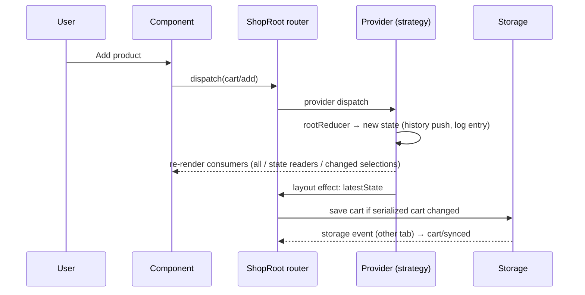

# Technical Design: Context + useReducer State Management

## Scope

**In scope:** mock shop API (catalog, checkout with latency and failure
injection, shared pricing and discount rules), a pure root reducer (cart
operations, history for undo/redo/time travel, action log with diffs,
checkout status) with a typed action union, three sharing strategies
(single context, split contexts, store + selectors), a render-counter
registry with per-action reports, persistence (versioned, Zod-validated,
v1 → v2 migration, cross-tab sync), async checkout with optimistic update
and rollback, the shop UI, demo controls, explanation guide, route and
catalog entry.

**Out of scope:** filtering/search, accounts, payments, state libraries,
persisting history, automated tests (none in the repo).

## Research Summary

> Sources: React docs (`useReducer`, `createContext`, "Scaling up with reducer and context", `useSyncExternalStore`, `memo`, `useEffectEvent`), MDN (`StorageEvent`, Web Storage, Web Animations), vercel-react-best-practices, ui-ux-pro-max.

- **Why a single context re-renders everyone:** a provider value `{ state, dispatch }` is a new object every render, and every `useContext` consumer re-renders when the value changes (`Object.is`). `memo` doesn't stop it, because context reads bypass props.
- **Split contexts:** `dispatch` from `useReducer` is stable, so a `DispatchContext` never changes; components that only dispatch stop re-rendering. Components reading `StateContext` still re-render on every change.
- **Selectors:** keep the state in a small store (`getState`, `dispatch`, `subscribe`) passed through context (the store object never changes); components subscribe with `useSyncExternalStore` and a selector. `getSnapshot` must return a cached value: the selected value is memoized per store state and compared with an equality function (`Object.is` or shallow), otherwise derived arrays/objects cause re-render loops.
- **Exhaustive actions:** a discriminated union over `type` with a `default` branch assigning to `never` makes an unhandled type a compile error.
- **Undo/time travel:** wrap cart states in a history (`states[]` + `index`); because the reducer never mutates, each state is a cheap snapshot (structural sharing). Each state carries an id so log entries survive the 50-state cap.
- **Impure data stays out of the reducer:** action creators stamp `id` and `at` (time); the reducer computes diffs and history purely.
- **Storage:** `localStorage` writes fire `storage` events in *other* same-origin tabs only, and only when the value changes, so writing an identical synced value doesn't ping-pong. Saved data is untrusted → Zod parse, then migrate, then reconcile against the catalog.
- **Async without middleware:** an async function dispatches `checkout/started` → awaits the API → `checkout/succeeded` or `checkout/failed`; it dispatches through a stable router so it still reaches the reducer after a strategy switch remounts the providers.
- **vercel-react-best-practices:** `memo` for list rows and Add buttons (`rerender-memo`), primitive selected values (`rerender-derived-state`), `useSyncExternalStore` for subscriptions, lazy initial state (`rerender-lazy-state-init`), refs for transient values (`rerender-use-ref-transient-values`), handlers in event callbacks not effects, `Map` for product lookups (`js-index-maps`).
- **ui-ux-pro-max:** product grid 2–4 columns responsive, cart as a sticky side panel on `lg+` and below the grid on smaller screens, steppers with ≥ 32 px targets and labelled ± buttons, inline discount errors, skeletons while loading, prices in tabular numerals, focus-visible on all controls, render-count highlight disabled under reduced motion.

## Patterns & Reuse

### Conventions to Follow

| Pattern | Project Uses | Avoid | Reference |
|---------|-------------|-------|-----------|
| API routes | Thin route → Zod (`parseBody`) → `server-only` store; `{ error: { message, issues? } }`, 400/422 | Logic in routes | src/app/api/practices/data-fetching-hook/users/route.ts:1, src/lib/http.ts |
| Shared schemas | `src/server/practices/{slug}/*.schema.ts` without `server-only` | Duplicated types | src/server/practices/data-fetching-hook/users.schema.ts |
| Long-lived mock state | `globalThis` holder | Module state duplicated by HMR | .agents/knowledge.md (feature 006 decision) |
| Client data fetching | Shared `useQuery` from practice 4 | Ad-hoc fetch in effects | src/practices/data-fetching-hook/use-query.ts:23 |
| Network settings | Module-level `network` object read at request time | Prop drilling | src/practices/data-fetching-hook/users-api.ts:10 |
| Notifications | `toast` | Inline status for results | src/practices/toast-notifications/toast-store.ts:317 |
| Confirmations | `confirm()` from the shared modal | Hand-rolled dialog | src/practices/accessible-modal/modal-store.ts |
| Demo/guide/registration | `DemoControls` + `DemoStage`, guide blocks, own route + `built: true` | — | src/practices/accessible-modal/demo.tsx |

### Existing Code to Reuse

| Component | Location | How to Use |
|-----------|----------|------------|
| `useQuery`, `HttpError` | src/practices/data-fetching-hook/use-query.ts, query-client.ts | Catalog loading, retry |
| `parseBody`, `jsonError` | src/lib/http.ts | Checkout route |
| `toast` | toast-store.ts | Order placed, storage notes, sync |
| `confirm()` | accessible-modal/modal-store.ts | "Clear cart?" |
| Button, Input, Skeleton | src/components/ui/* | UI |

## Data Model

### Entities

| Entity | Purpose |
|--------|---------|
| Product | Catalog item (server-generated) |
| Cart | `{ lines: { productId, qty }[], discount: DiscountCode \| null }` |
| History | `{ states: { id, cart }[], index }` |
| LogEntry | One dispatched action with summary and diff |
| CheckoutState | idle / pending / succeeded / failed |
| AppState | Root reducer state |
| SavedCartV1 / V2 | Persisted formats |

#### Product (`src/server/practices/context-reducer/shop.schema.ts`)

- `id` (string `p01`…`p12`), `name` (string), `price` (cents, int), `stock` (int 1–12), `color` (one of the chart tokens, for a swatch)

#### AppState (`src/practices/context-reducer/shop-reducer.ts`)

- `history` (History; `states[index].cart` is the present cart)
- `nextStateId` (number)
- `log` (LogEntry[], newest first, max 100)
- `checkout` ({ status: "idle" } | { status: "pending", snapshot: Cart } | { status: "succeeded", order } | { status: "failed", message, adjustments: Adjustment[] })
- `hydrated` (boolean: saved cart applied)
- `notice` (string | null: last eligibility/hydration message)

#### LogEntry

- `id` (number), `at` (ms), `type` (action type), `summary` (string), `changes` (string[]), `stateId` (number | null: set for cart changes, used to jump)

#### Action union

- `cart/add` { productId, stock } · `cart/setQty` { productId, qty, stock } · `cart/remove` { productId } · `cart/clear` · `cart/applyDiscount` { code } · `cart/removeDiscount`
- `history/undo` · `history/redo` · `history/jump` { stateId } · `log/clear`
- `cart/hydrated` { cart, notes } · `cart/synced` { cart }
- `catalog/loaded` { count }
- `checkout/started` · `checkout/succeeded` { order } · `checkout/failed` { message, adjustedCart?, adjustments }
- every action carries `meta: { id, at }` from its creator

#### Checkout API contract

| Endpoint | Method | Request | Response |
|----------|--------|---------|----------|
| /api/practices/context-reducer/products | GET `?latencyMs` | — | `{ data: Product[] }` |
| /api/practices/context-reducer/checkout | POST `?latencyMs&fail=none\|network\|conflict` | `{ lines: { productId, qty, unitPrice }[] (1–50), discount: string \| null, expectedTotal }` | 200 `{ data: { orderId, total, placedAt } }` · 409 `{ error: { message, issues: { adjustments: { productId, kind: "stock" \| "price", value }[] } } }` · 500 · 422 |

### Relationships

Cart lines reference products by id; prices and stock always come from the catalog (never saved). Log entries reference history states by `stateId`.

### Currently Exposed Fields

| AC ID | Field | Source (file:line) | Currently Exposed? | Gap? |
|-------|-------|--------------------|--------------------|------|
| AC-005 | item count, line totals, subtotal, discount, shipping, total | none | no | must add (`priceCart` in shop.schema.ts) |
| AC-016 | type, summary, time, changes | none | no | must add (LogEntry) |

## Decisions

| Decision | Rationale |
|----------|-----------|
| One root reducer (cart ops + history + log + checkout) shared by all three strategies | Strategies differ only in how components subscribe, so the comparison is fair |
| Pricing/discount rules in the shared schema file, used by client and server | Client totals and server re-check can't drift |
| Catalog stays in the `useQuery` cache, not in the reducer; actions carry `stock` | The catalog is server data with its own cache; the reducer owns client state only |
| History of cart states with stable ids; jump = move the pointer; new change truncates the future; cap 50 (+ present) | Undo, redo and time travel are one mechanism |
| Log in reducer state; creators stamp `meta.id`/`meta.at`; diffs computed in the reducer | Reducer stays pure and the log is part of the state the strategies share |
| Optimistic checkout via `checkout.snapshot`: the visible cart is empty while pending, history untouched; success resets history to an empty cart; failure leaves history as is (adjustments pushed as a new state) | Rollback is free (the real cart never left); undo can't resurrect a purchased cart |
| `ShopRoot` owns the strategy, a `latestState` ref (providers report it in a layout effect) and a stable `dispatch` router; switching passes `latestState` as the new provider's initial state | Keeps cart/history/log across switches; async work dispatches to whichever provider is mounted |
| Consumer hooks call all three contexts unconditionally and `useSyncExternalStore` with a no-op subscription when no store | Rules of hooks hold; unused contexts subscribe to nothing |
| `useShopSelector(selector, isEqual = Object.is)` memoizes the selected value per state | Stable snapshots; arrays use a shallow comparison |
| Render counter: layout effect (no deps) increments a module registry and writes the badge text + a Web Animations flash; reports group renders between a dispatch and the next frame | Counts committed renders without setState; the counters don't cause renders |
| Saved cart: key `rp.context-reducer.cart`, v2 `{ version: 2, lines, discount }`, v1 `{ items: Record<id, qty>, coupon? }`; Zod parse → migrate → reconcile with the catalog (drop unknown, clamp to stock, re-check discount) → notes | Untrusted input handled at the boundary; migration is a pure function |
| Hydrate after mount, once the catalog query settles; until then the cart shows skeleton lines | No SSR mismatch and no flash of an empty cart |
| `storage` event → `cart/synced` (history reset); writes only when the serialized cart changed | Cross-tab sync without loops |
| Keyboard undo on `document` keydown, ignored when the target is an input, textarea, select or contenteditable, or while checkout is pending | Field undo keeps working (AC-014) |
| Clear cart asks with the shared `confirm()` | Reuses practice 8; destructive and undoable anyway |
| Discount form reads the item count at submit time through `readShopState()` instead of subscribing | Keeps it out of every add's re-renders (selectors budget) |
| Hydration waits for the query's `status !== "loading"`; migration notes and catalog-check notes are merged; the session's saved marker is cleared so a migrated cart is re-saved as v2 | Found in verification: `error` starts as `null`, and setting the marker first left v1 data in storage |
| Persistent outline on the components of the last action, plus a sticky scoreboard with per-strategy bars; 12 products instead of 24 | User feedback: 60 identical badges and results a scroll away made cause and effect impossible to follow |
| Outline and badge flash, then fade after 1.5 s; the scoreboard and history keep the record | User feedback: persistent highlights stayed on everything (in Single context every component re-renders), so they carried no signal |

## Component Design

| Component | File | Action | Responsibility |
|-----------|------|--------|----------------|
| Shop schema | src/server/practices/context-reducer/shop.schema.ts | new | Product type, discount codes, `priceCart`, `checkDiscount`, checkout request/response schemas |
| Shop store | src/server/practices/context-reducer/shop.store.ts | new | `server-only`; 24 products; checkout validation, failure injection, order numbers on `globalThis` |
| Routes | src/app/api/practices/context-reducer/{products,checkout}/route.ts | new | Thin adapters |
| Shop API | src/practices/context-reducer/shop-api.ts | new | `network` settings, `fetchProducts`, `postCheckout` |
| Cart ops | src/practices/context-reducer/cart.ts | new | Pure cart functions, `reconcile`, `diffCarts`, `itemCount` |
| Reducer | src/practices/context-reducer/shop-reducer.ts | new | Action union + creators, root reducer, history, log, exhaustive check |
| Store | src/practices/context-reducer/shop-store.ts | new | `createStore(reducer, initial)` |
| Context + hooks | src/practices/context-reducer/shop-context.tsx | new | Three providers, `useShopSelector`, `useShopDispatch`, selectors |
| Storage | src/practices/context-reducer/cart-storage.ts | new | Zod formats, read/migrate/write, v1 sample, corrupt sample |
| Render counter | src/practices/context-reducer/render-counter.tsx | new | Registry, `useRenderCount`, `<RenderBadge>`, reports store |
| Root | src/practices/context-reducer/shop-root.tsx | new | Strategy switch + handoff, router dispatch, catalog query, hydration, persistence, sync, checkout runner |
| Shop UI | src/practices/context-reducer/{shop-header,product-grid,cart-panel,undo-bar,action-log,render-reports}.tsx | new | Consumers |
| Scoreboard | src/practices/context-reducer/scoreboard.tsx | new | Sticky strategy switch + last action result + per-strategy bars (AC-028) |
| Demo / guide | src/practices/context-reducer/{demo,explanation}.tsx | new | Controls + layout; guide |
| Page + catalog | src/app/(playground)/practices/context-reducer/page.tsx, src/practices/catalog.ts | new / modify | Route; `built: true` |

### Visual direction (ui-ux-pro-max)

- Stage (revised after user feedback "too difficult to track"): a sticky scoreboard under the top bar (strategy switch; last action "N of M components re-rendered"; one single-hue bar per strategy with direct value labels for that action type, "not yet" when unmeasured) → shop header + undo bar on one row → `lg:grid-cols-[minmax(0,1fr)_20rem]` with a compact 12-product grid (`grid-cols-2 sm:grid-cols-3`) and the cart → bottom row `md:grid-cols-2`: action log and re-render history.
- Product card (compact): small swatch, name (truncated with title), render badge on one row; price and "In cart: N" / stock on the next; Add button + its own badge.
- Re-render feedback: components that re-rendered for an action flash for 1.5 s (`data-flash`, set by the render registry on the badge and the nearest `data-render-root`: outline plus emphasised badge), then fade back (instant under `prefers-reduced-motion`). Outline uses the warning token darkened 25% in light mode (6.3:1 on the surface; 11.5:1 in dark).
- Cart: lines with − / qty input / + (labelled "Decrease/Increase quantity of …"), remove; discount field with Apply and inline error; totals in a `dl` with tabular numerals; Checkout button with pending spinner; order/failure panel with Retry.

## Data Flow

## Requirements Traceability

| Requirement | Component | File | Status |
|-------------|-----------|------|--------|
| AC-001 | Catalog query + grid | shop-root.tsx, product-grid.tsx | Done |
| AC-002 | `cart/add` | cart.ts, product-grid.tsx | Done |
| AC-003 | `cart/setQty`, remove, clear | cart.ts, cart-panel.tsx | Done |
| AC-004 | `checkDiscount`, DiscountForm | shop.schema.ts, cart-panel.tsx | Done |
| AC-005 | `priceCart`, badge, totals | shop.schema.ts, shop-header.tsx, cart-panel.tsx | Done |
| AC-006 | Eligibility re-check in reducer | shop-reducer.ts | Done |
| AC-007 | Render badges | render-counter.tsx | Done |
| AC-008 | Strategy switch + handoff | shop-root.tsx, shop-context.tsx | Done |
| AC-009 | Reports | render-counter.tsx, render-reports.tsx | Done |
| AC-010 | Strategy semantics | shop-context.tsx | Done |
| AC-011 | Reset counters | render-counter.tsx | Done |
| AC-012–015 | History | shop-reducer.ts, undo-bar.tsx | Done |
| AC-016–019 | Log + jump | shop-reducer.ts, action-log.tsx | Done |
| AC-020–023 | Persistence + sync | cart-storage.ts, shop-root.tsx | Done |
| AC-024–026 | Checkout | shop-root.tsx, shop-reducer.ts, shop.store.ts | Done |
| AC-027 | Checkout controls | demo.tsx, shop-api.ts | Done |

## Test Strategy

### Infrastructure

| Aspect | Detail |
|--------|--------|
| Framework | None in repo; gate `pnpm typecheck && pnpm lint && pnpm build` |
| Logic checks | Scratchpad script via `jiti`: reducer purity (deep-frozen states), 100 random actions → undo/redo equality, migration/reconcile, pricing |
| UI checks | Puppeteer MCP on a production build: render counts per strategy, persistence across reload, two tabs (single-tab caveat from 006 noted: storage events don't need rAF), checkout failure modes, axe both themes, 360 px |

### New Tests

| Component | Test File | Scenarios |
|-----------|-----------|-----------|
| Reducer, cart, storage, pricing | scratchpad script (not committed) | purity, history, jump, cap, eligibility, migrate v1, corrupt input, reconcile |
| UI | Puppeteer scripts | strategies' render counts, undo shortcuts in/out of inputs, log jump totals, reload, v1 load, sync, checkout success/network/conflict, rollback equality |

## Considerations

### Error Handling

- Catalog errors show inline with Retry (query `refetch`); checkout errors show inline with Retry; storage failures toast once and continue in memory.
- Server re-validates every line and the total; conflicts return machine-readable adjustments.

### Security

- Request bodies validated with Zod; quantities bounded; saved data validated before use.

## Open Questions

- None.
