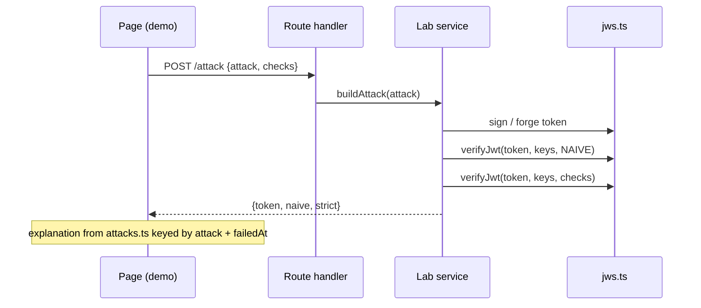

# Technical Design: Security section, JSON Web Tokens

## Scope

In scope: a fifth handbook section `security` (catalog, icon, sidebar
folder, section route, home card) and its first topic page `jwt`
(`/security/jwt`) with five topics and five client demos, backed by a
hand-built JWS implementation on `node:crypto` and four small server labs
(tokens + attacks, lifecycle sessions, cookie storage, key ring).

Out of scope: see spec. No new npm dependency (no `jose`/`jsonwebtoken`):
the attack demo needs a verifier whose individual checks can be turned
off, and the site hand-builds what it teaches.

## Research Summary

Knowledge chain: codebase → Node 22 docs (`crypto`) → RFC 7515/7518/7519,
RFC 8725 (JWT BCP), OWASP JWT cheat sheet. No research cache needed; facts used:

- JWS compact = `b64url(header) . b64url(payload) . b64url(sig)`; signing input
  is the ASCII of the first two parts joined by `.` (RFC 7515 §5.1).
- HS256 = HMAC-SHA256; RS256 = RSASSA-PKCS1-v1_5 SHA-256; ES256 = ECDSA P-256
  SHA-256 with the signature as raw `r‖s` (64 bytes), not DER (RFC 7518 §3.4)
  → Node `crypto.sign("sha256", data, { key, dsaEncoding: "ieee-p1363" })`.
- Node `KeyObject.export({ format: "jwk" })` gives public JWKs;
  `crypto.createPublicKey({ key: jwk, format: "jwk" })` imports one (used by
  the embedded-`jwk` attack).
- RFC 8725 §3.1: verifiers must pin algorithms per key and never let the
  token choose; §3.2 never accept `none` unless explicitly intended; §3.8/3.9
  validate `iss`/`aud`. The `jwk` header attack is CVE-2018-0114 class.
- Cookies: `SameSite=None` needs `Secure`; Chrome accepts `Secure` cookies on
  `http://localhost`. A request from an opaque-origin (sandboxed) frame is
  cross-site for SameSite purposes. **Verify in the browser during T006**
  (third-party-cookie rules may also apply); the demo shows whatever the
  server log says, so a surprise changes the note, not the mechanism.

## Patterns & Reuse

### Conventions to Follow

| Pattern | Project Uses | Avoid | Reference |
|---------|-------------|-------|-----------|
| Topic page | catalog entry + route + `src/handbook/{slug}/content.tsx` with `Topic`/`Toc` | custom frame | `src/app/(playground)/browser-platform/origins-and-cors/page.tsx:1` |
| Server lab state | `globalThis` maps capped by `MAX_RUNS`, lazily created | I/O at import (build runs modules) | `src/server/handbook/cors-lab.service.ts:7` |
| Route handler | thin: Zod `safeParse` → service → `Response.json({ data })`, `jsonError` 400/422 | logic in route | `src/app/api/handbook/cors/route.ts:7` |
| Body parsing | `parseBody(request, schema)` | manual `JSON.parse` | `src/lib/http.ts:13` |
| Client-safe shared logic in server tree | pure module without `server-only` | duplicating decode logic | knowledge.md feature:014 (`grid.query.ts`) |
| Cross-origin sender | sandboxed `srcdoc` iframe, `postMessage` with source check | second domain | `src/handbook/origins/cors-demo.tsx:12` |
| Demo pieces | `Toggle`, `Verdict` | colour-only pass/fail | `src/handbook/ui.tsx:9` |
| Handlers | named `handleX` above return | multi-line inline handlers | `.claude/rules/05-event-handlers.md` |

### Existing Code to Reuse

| Component | Location | How to Use |
|-----------|----------|------------|
| `Topic`, `Toc` | `src/handbook/topic.tsx:7`, `src/handbook/toc.tsx:4` | each of the five topics |
| `TopicFrame` | `src/components/playground/topic-frame.tsx:7` | page header + breadcrumbs (via `page.section`) |
| `SectionIndex`, `sectionMetadata` | `src/components/playground/section-index.tsx:8` | `/security` route |
| `Toggle`, `Verdict` | `src/handbook/ui.tsx` | check switches, pass/fail |
| `Button`, `Input`, `Textarea`, `Select` | `src/components/ui/*` | controls |
| `jsonError`, `parseBody` | `src/lib/http.ts` | all routes |
| sandboxed sender pattern | `src/handbook/origins/cors-demo.tsx:12-27` | cross-site cookie request (copy, smaller) |

## Data Model

### Entities

| Entity | Purpose |
|--------|---------|
| Section (catalog) | add `security` |
| TopicPageMeta (catalog) | add `jwt` page |
| DecodedToken (new, client-safe) | result of decoding compact text |
| VerifyChecks / CheckResult (new) | which checks run, and each outcome |
| ServerKey (new) | a signing key with kid, alg, public JWK |
| LabSession (new) | lifecycle demo state per tab |
| CookieRun log (new) | what the cookie API received |
| KeyRing (new) | per-run rotation state |

#### Section / TopicPageMeta (existing)

- `SectionId` union -- `src/practices/catalog.ts:10` (add `"security"`)
- `sections[]` `{ id, title, summary, href }` -- `src/practices/catalog.ts:22` (insert before `system-design`)
- `TopicSectionId` = `Exclude<SectionId, "react-practices" | "system-design">` -- `src/practices/catalog.ts:184` (picks up `security` automatically)
- `topicPages[]` `{ section, slug, title, summary, written }` -- `src/practices/catalog.ts:194`
- `SECTION_PATH: Record<TopicSectionId, string>` -- `src/practices/catalog.ts:239` (must add `security`, typecheck enforces)
- `ICONS: Record<SectionId, LucideIcon>` -- `src/components/playground/section-icon.tsx:5` (must add, typecheck enforces)
- `FOLDERS` -- `src/components/playground/app-sidebar.tsx:29` (add `topicFolder("security")`)

#### DecodedToken (new, `jwt-format.ts`)

- `parts: [string, string, string]`, `header: unknown | null`, `payload: unknown | null`, `errors: { part: "token" | "header" | "payload" | "signature"; message }[]`, `signatureBytes: number`

#### VerifyChecks (new, `jwt.schema.ts`)

- `pinAlg` (boolean): accept only the algorithm the key is registered for; rejects `none`
- `serverKeys` (boolean): take the key from the server's key set by `kid`, ignore `jwk`/`jku` in the header
- `exp` (boolean): `exp` / `nbf` with leeway
- `iss` (boolean), `aud` (boolean)
- Naive = all false; strict = all true.

#### CheckResult (new)

- `{ id: "format" | "alg" | "key" | "signature" | "exp" | "nbf" | "iss" | "aud"; status: "pass" | "fail" | "skipped"; detail: string }`; verify result `{ valid, checks, header, payload, failedAt?: id }`

#### ServerKey (new, server-only)

- `kid` (string, includes boot id so a restart invalidates old tokens), `alg` ("HS256" | "RS256" | "ES256"), `privateKey | secret`, `publicKey?`, `jwk?` (public JWK with `kid`, `alg`, `use: "sig"`), `pem?` (public SPKI PEM, published for the confusion attack)

#### LabSession (new, server-only, `globalThis.__jwtSessions`, cap 200)

- `sid`, `accessTtl` (s), `revocation: "none" | "denylist" | "version"`, `version` (int), `denylist: Map<jti, exp>`, `refresh: Map<hash, { id, usedAt?, family }>` (stores SHA-256 of the opaque refresh token, never the token), `revoked: boolean`, `log: { at, kind, ok, detail }[]` (cap 100)

#### Cookie log entry (new)

- `{ n, at, via: "cookie" | "header" | "none", origin, secFetchSite, sameSite, ok, detail }`

#### KeyRing (new, per run, cap 200)

- `keys: { kid, status: "active" | "next" | "retired", createdAt, key: ServerKey }[]`, `signingKid`

### Relationships

LabSession 1→N refresh entries (one family per sign-in); access tokens carry
`sid`, `jti`, `ver` claims that point back to the session. KeyRing 1→N keys;
tokens point at a key by `kid`.

### API Contracts

All under `/api/handbook/jwt`, `Cache-Control: no-store`, errors via `jsonError`.

| Endpoint | Method | Request | Response `data` |
|----------|--------|---------|-----------------|
| `/token` | POST | `{ alg, sub, role, ttl }` (ttl −3600…86400) | `{ token }` |
| `/verify` | POST | `{ token ≤8 KB }` | `VerifyResult` (strict, leeway 0) |
| `/attack` | POST | `{ attack, checks: VerifyChecks }` | `{ token, naive: VerifyResult, strict: VerifyResult, publicKeyPem }` |
| `/session` | POST | `{ action: "login", accessTtl, revocation }` · `{ action: "refresh", sid, refreshToken }` · `{ action: "logout", sid, accessToken }` | `{ sid, accessToken, refreshToken, expiresAt }` · same · `{ revoked }`; errors 401 with reason |
| `/session/api` | GET | `?sid&leeway` + `Authorization: Bearer` | `{ ok, sub, checks }` or 401 `{ error.message }` |
| `/session/log` | GET | `?sid` | `{ entries, state: { version, denylist, refreshTokens, revoked } }` |
| `/cookie` | POST / DELETE | `{ run, sameSite }` / `?run` | sets/clears `hb_jwt` HttpOnly; Path=/api/handbook/jwt; `Secure` |
| `/cookie/api` | GET, OPTIONS | `?run&n`, cookie or Bearer | `{ ok, via }`; CORS echo `Origin` + credentials so the sandbox can call it |
| `/cookie/log` | GET | `?run` | `{ entries }` |
| `/keys` | GET | `?run` | JWKS `{ keys: Jwk[] }` + `{ ring }` (status per kid; no private material) |
| `/keys` | POST | `{ run, action: "add" \| "promote" \| "retire" \| "sign" \| "verify", kid?, token? }` | ring, or `{ token }`, or `VerifyResult` |

### Currently Exposed Fields

| AC ID | Field | Source (file:line) | Currently Exposed? | Gap? |
|-------|-------|--------------------|--------------------|------|
| AC-001 | section card title/summary/progress | `src/app/(playground)/page.tsx:15` reads `sectionProgress` (`catalog.ts:262`) | yes (generic) | must add catalog entry |
| AC-002 | sidebar folder | `app-sidebar.tsx:29` | no | must add |
| AC-003 | breadcrumbs/title/intro | `topic-frame.tsx:9` | yes (generic) | none |
| AC-004..021 | token, checks, logs | none | no | new |

## Decisions

| Decision | Rationale |
|----------|-----------|
| Hand-built JWS on `node:crypto` (sign + verify) | Need per-check switches for the naive/strict comparison; no new dependency; teaches the real mechanism |
| One verifier with `VerifyChecks`; naive = all off | Each attack is then blocked by exactly one check, which is what AC-010 shows; avoids two drifting implementations |
| Naive mistakes = token picks the alg, token may bring its key, claims unchecked | These are the three real-world classes (RFC 8725 §2.1, CVE-2018-0114, missing aud/iss); a "decode without verify" bug would make every attack trivially pass and teach less |
| Key confusion: the attack API expects RS256; naive verify uses the RSA public key PEM as "the key" whatever alg says | Exactly how the historic library bug worked; the PEM is public, returned to the page |
| Global demo keys (HS secret, RSA 2048, EC P-256) created lazily on `globalThis`; `kid` = `{alg}-{bootId}` | Restart invalidates old tokens with "unknown key id" (edge case), no I/O at import |
| Refresh tokens are opaque random 32 bytes, stored as SHA-256 | Senior practice; shows that refresh tokens needn't be JWTs and must be revocable |
| Reuse of a used refresh token → session `revoked`, refresh fails for everyone; access tokens rejected immediately only when revocation mode is `denylist` or `version` | Truthful: stateless access tokens can't be recalled without server state; that contrast is AC-014 |
| Leeway passed by the client per API call | It's a server setting, but making it a demo control avoids re-login; labelled as a setting the server would own |
| Cookie demo uses its own path `/api/handbook/jwt` and name `hb_jwt` | The cookie never rides along with other site requests |
| Cross-site request from a sandboxed opaque-origin iframe (019 pattern) | Real cross-site request without a second domain |
| "Injected script" = a real function run in the page: reads storage and `document.cookie`, scans `window`, and wraps `fetch` to capture `Authorization` on the app's next call | Shows the senior point: in-memory tokens resist reading but not a patched `fetch`; HttpOnly resists reading but XSS can still make requests |
| Key rotation ring is per run (tab) | Rotation by one visitor must not break others |
| Pure decode/format module `src/server/handbook/jwt/jwt-format.ts` without `server-only` | Used by the client decoder and the server verifier (feature 014 precedent) |
| Token parts coloured `text-info` (header), `text-success` (payload), `text-foreground/75` (signature), always with a legend in words | Theme tokens with ≥4.5:1 in both themes; never colour alone |
| Countdown computed from `expiresAt` each tick (`setInterval` 250 ms + `visibilitychange`) | Correct after a hidden tab (edge case), no drift |

## Component Design

| Component | File | Action | Responsibility |
|-----------|------|--------|----------------|
| Catalog | `src/practices/catalog.ts` | modify | `security` section + `SECURITY_PATH`, `jwt` topic page |
| Section icon | `src/components/playground/section-icon.tsx` | modify | `ShieldCheck` |
| Sidebar | `src/components/playground/app-sidebar.tsx` | modify | `topicFolder("security")` |
| Home page copy | `src/app/(playground)/page.tsx` | modify | mention Security in intro |
| Section route | `src/app/(playground)/security/page.tsx` | new | `SectionIndex` |
| Page route | `src/app/(playground)/security/jwt/page.tsx` | new | `TopicFrame` + `JwtHandbook` |
| Format | `src/server/handbook/jwt/jwt-format.ts` | new | base64url, split/decode with errors, claim descriptions |
| Schema | `src/server/handbook/jwt/jwt.schema.ts` | new | Zod bodies, `VerifyChecks`, result types, attack ids |
| JWS core | `src/server/handbook/jwt/jws.ts` | new (server-only) | demo keys, `signJwt`, `verifyJwt(token, keys, checks, opts)` |
| Token lab | `src/server/handbook/jwt/token-lab.service.ts` | new | issue, verify, build attacks |
| Session lab | `src/server/handbook/jwt/session-lab.service.ts` | new | login/refresh/logout/api/log |
| Cookie lab | `src/server/handbook/jwt/cookie-lab.service.ts` | new | set/clear cookie, api, log |
| Key ring | `src/server/handbook/jwt/key-ring.service.ts` | new | add/promote/retire/sign/verify, JWKS |
| Routes | `src/app/api/handbook/jwt/{token,verify,attack,session,session/api,session/log,cookie,cookie/api,cookie/log,keys}/route.ts` | new | thin adapters |
| Content | `src/handbook/jwt/content.tsx` | new | intro, TOC, five `Topic`s, read-more |
| Shared UI | `src/handbook/jwt/token-view.tsx` | new | coloured token + legend, JSON view, checks list, `postJson` helper |
| Anatomy demo | `src/handbook/jwt/anatomy-demo.tsx` | new | AC-004..007 |
| Attacks demo | `src/handbook/jwt/attacks-demo.tsx` + `attacks.ts` | new | AC-008..010 (explanations in `attacks.ts`) |
| Lifecycle demo | `src/handbook/jwt/lifecycle-demo.tsx` | new | AC-011..014 |
| Storage demo | `src/handbook/jwt/storage-demo.tsx` | new | AC-015..018 |
| Keys demo | `src/handbook/jwt/keys-demo.tsx` | new | AC-019..020 |

## Data Flow

Lifecycle: login → `{access, refresh}` → page counts down from `expiresAt`
→ `GET /session/api` with Bearer → 200/401 + log → refresh rotates (old hash
marked used) → "attacker" replays old refresh → service sees `usedAt` →
`revoked = true` → both parties' refresh fails; api call fails if revocation
mode keeps state.

## Requirements Traceability

| Requirement | Component | File | Status |
|-------------|-----------|------|--------|
| AC-001 | catalog, home | `catalog.ts`, `page.tsx` | Planned |
| AC-002 | sidebar, section route | `app-sidebar.tsx`, `security/page.tsx` | Planned |
| AC-003 | page route, content | `security/jwt/page.tsx`, `content.tsx` | Planned |
| AC-004 | token lab, anatomy demo | `token-lab.service.ts`, `anatomy-demo.tsx` | Planned |
| AC-005 | format, anatomy demo | `jwt-format.ts`, `anatomy-demo.tsx` | Planned |
| AC-006 | jws verify, anatomy demo | `jws.ts`, `token-view.tsx` | Planned |
| AC-007 | anatomy demo note | `anatomy-demo.tsx` | Planned |
| AC-008 | token lab attacks | `token-lab.service.ts`, `attacks-demo.tsx` | Planned |
| AC-009 | explanations | `attacks.ts` | Planned |
| AC-010 | check switches | `attacks-demo.tsx`, `jws.ts` | Planned |
| AC-011..014 | session lab, lifecycle demo | `session-lab.service.ts`, `lifecycle-demo.tsx` | Planned |
| AC-015..018 | cookie lab, storage demo | `cookie-lab.service.ts`, `storage-demo.tsx` | Planned |
| AC-019..020 | key ring, keys demo | `key-ring.service.ts`, `keys-demo.tsx` | Planned |
| AC-021 | content read-more | `content.tsx` | Planned |

## Test Strategy

### Infrastructure

| Aspect | Detail |
|--------|--------|
| Framework | none in repo; quality gate `pnpm typecheck && pnpm lint && pnpm build` |
| Command | node scripts in the scratchpad (curl / fetch against `next start`) + Puppeteer MCP in the browser |
| Location | scratchpad only (not committed), matching prior features |

### New Tests

| Component | Test File | Scenarios |
|-----------|-----------|-----------|
| jws / token lab | scratchpad `jwt-check.mjs` | each alg signs + verifies; 1-char tamper fails signature; each attack: naive valid, strict invalid with expected `failedAt`; each single check off lets exactly its attack through |
| session lab | scratchpad script | login, expiry with leeway 0 vs 30, rotate, reuse → revoked, revocation modes |
| cookie / storage | browser | HttpOnly unreadable; injected script captures Bearer from memory mode; SameSite results from the sandbox, recorded |
| keys | scratchpad script | old kid verifies until retired, then "unknown key id" |
| page | browser | axe light + dark, 360 px no horizontal scroll, keyboard |

## Considerations

### Error Handling

- Routes: 400 bad JSON, 422 validation, 401 for token failures with a reason in `error.message`; demos show the message in words in a polite live region.
- Decode never throws: errors are returned per part.
- Storage access wrapped in try/catch (private mode), cookie success checked by a same-origin call to `/cookie/api`.

### Security

- Secrets (HS secret, private keys) never leave `jws.ts`; JWKS returns public members only (`kty, n, e, crv, x, y, kid, alg, use`).
- Inputs capped (token 8 KB, claims short strings) to avoid CPU abuse; maps capped.
- The naive verifier exists only for demo tokens issued by this lab; nothing else on the site authenticates with it.
- The injected script is a fixed function in the bundle, not `eval` of user text; it restores `fetch` after one capture or 10 s.

## Open Questions

- [ ] Exact SameSite outcome for an opaque-origin frame request in current Chrome (verify in T006; the note follows the measured result).
