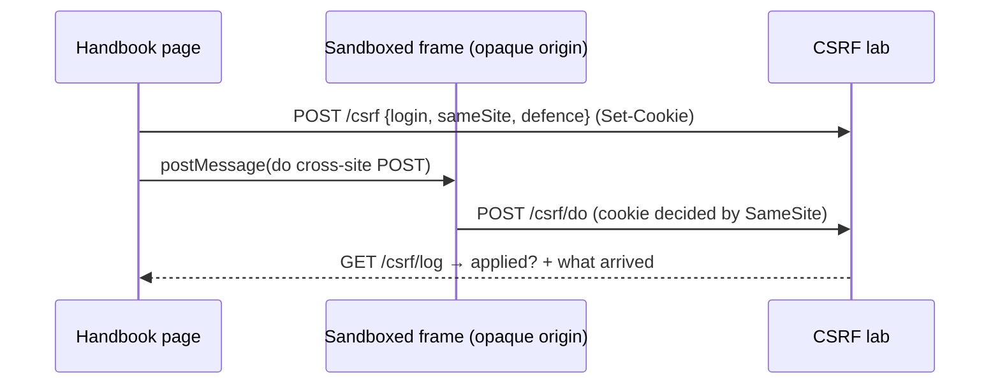

# Technical Design: Security page, XSS, CSP and CSRF

## Scope

In scope: a second Security topic page `xss-csp-csrf` (`/security/xss-csp-csrf`)
with three topics and three client demos, a sample page served with an
arbitrary CSP header, and one small CSRF server lab. In scope too: one link
from the JWT page's storage topic.

Out of scope: see spec. No new npm dependency; encoding helpers are a few
lines, sanitizing is explicitly not the lesson.

## Research Summary

Knowledge chain: codebase → Next 16 docs (CSP guide, route handler headers) →
OWASP XSS/CSRF cheat sheets, MDN CSP.

- A route handler returns a `Response`; its `headers` can carry an arbitrary
  `Content-Security-Policy`. Serving an HTML document from a route into a
  visible same-origin iframe is the established render-lab pattern
  (`render-lab.service.ts`, feature 020).
- The `securitypolicyviolation` event fires on `document` in the page the CSP
  governs, with `effectiveDirective`, `blockedURI`, `violatedDirective`. The
  sample page posts those to the parent over `postMessage` — reliable, unlike
  `report-uri` delivery under automation.
- An opaque-origin sandboxed iframe (`sandbox="allow-scripts"`, `srcDoc`) is a
  real cross-site caller (`Origin: null`) and runs attacker code that can't
  touch the parent (no `allow-same-origin`) — features 019/021.
- A cookie is sent on a cross-site POST only when `SameSite=None; Secure`;
  `Lax`/`Strict` hold it back. `Lax` still allows top-level GET navigations, so
  it is not a complete CSRF defence (MDN). Verify the live outcome in T00x; the
  demo shows the server log, so a surprise changes the note, not the mechanism.
- Nonce/hash let specific inline scripts run under a strict policy;
  `strict-dynamic` lets a trusted script load more without host allowlists.

## Patterns & Reuse

### Conventions to Follow

| Pattern | Project Uses | Reference |
|---------|-------------|-----------|
| Topic page | catalog entry + route + `src/handbook/{slug}/content.tsx` with `Topic`/`Toc` | `src/app/(playground)/security/jwt/page.tsx` |
| Served sample page | HTML built from validated enums, into a same-origin iframe; `no-store` | `src/server/handbook/render-lab.service.ts:1` |
| Opaque-origin attacker frame | sandboxed `srcdoc`, `postMessage` with `event.source` check | `src/handbook/jwt/storage-demo.tsx` (OTHER_SITE), `src/handbook/origins/cors-demo.tsx:12` |
| Server lab state | `globalThis` map capped by MAX_RUNS, lazy | `src/server/handbook/cors-lab.service.ts:7` |
| Route handler | thin: Zod `safeParse`/`parseBody` → service → `Response.json({ data })` | `src/app/api/handbook/jwt/cookie/route.ts` |
| Demo pieces | `Toggle`, `Verdict`, and `Choice`/`fetchJson`/`newRun` | `src/handbook/ui.tsx`, `src/handbook/jwt/token-view.tsx` |
| Handlers | named `handleX`; one-line inline only | `.claude/rules/05-event-handlers.md` |

### Existing Code to Reuse

| Component | Location | How |
|-----------|----------|-----|
| `Topic`, `Toc` | `src/handbook/topic.tsx`, `toc.tsx` | the three topics |
| `TopicFrame`, `SectionIndex` | `src/components/playground/*` | header + section (already support `security`) |
| `Toggle`, `Verdict` | `src/handbook/ui.tsx` | switches, pass/fail |
| `Choice`, `fetchJson`, `newRun` | `src/handbook/jwt/token-view.tsx` | reused by the new demos (import across the section) |

## Data Model

### Entities

| Entity | Purpose |
|--------|---------|
| TopicPageMeta (catalog) | add `xss-csp-csrf` page |
| XssSink / XssResult (client) | sink choice and whether a payload ran |
| CspPolicy / Violation (client) | the policy the learner built and what the sample page reported |
| CsrfSession / CsrfLog (server) | demo session, cookie policy, state, request log |

#### TopicPageMeta (existing) — `src/practices/catalog.ts`

- `topicPages[]` `{ section, slug, title, summary, written }` — add one row with `section: "security"`. `TopicSectionId` already includes `security`; `sectionPages`/`sectionProgress`/sidebar pick it up with no further change.

#### Xss (client only, no server)

- `sink: "html" | "text" | "attr" | "href"`, `payload: string`, `encode: boolean`
- result reported from the sandbox: `{ executed: boolean; where: string; note: string }`

#### Csp (`csp-lab` via query)

- policy: `{ scriptSrc: "none" | "self" | "nonce" | "unsafe-inline" | "strict-dynamic"; allowImg: boolean; reportOnly: boolean }`
- the sample page attempts: inline script, nonced inline script, external script (`/api/handbook/security/csp/asset`), an image
- `Violation = { directive: string; blockedUri: string; sample?: string }` posted from the page

#### Csrf (server, `globalThis.__csrfLab`, cap 200)

- session: `{ sid; sameSite: "None"|"Lax"|"Strict"; defence: "none"|"token"|"header"; token: string; balance: number }`
- `CsrfLogEntry = { n; at; from: "page" | "other-site"; method; origin; fetchSite; cookie: boolean; tokenOk: boolean; headerOk: boolean; applied: boolean; detail }`

### API Contracts

All under `/api/handbook/security`, `Cache-Control: no-store`.

| Endpoint | Method | Request | Response |
|----------|--------|---------|----------|
| `/csp/page` | GET | policy enums in query | `text/html` sample page, with the built `Content-Security-Policy[-Report-Only]` header |
| `/csp/asset` | GET | — | a tiny `application/javascript` file (the "external script") |
| `/csrf` | POST | `{ action: "login", sameSite, defence }` · `{ action: "reset", sid }` | `{ sid, token, balance, ... }` (Set-Cookie on login) |
| `/csrf/do` | POST, OPTIONS | `?sid&n&from`, cookie + optional token/header | performs the transfer if allowed; `{ applied, balance }` or refusal |
| `/csrf/log` | GET | `?sid` | `{ entries, state }` |

### Currently Exposed Fields

| AC ID | Field | Source (file:line) | Exposed? | Gap |
|-------|-------|--------------------|----------|-----|
| AC-001 | section progress 2/2, sidebar, card | `catalog.ts` `topicPages`/`sectionProgress`; `app-sidebar.tsx` `topicFolder("security")` | yes (generic) | add catalog row |
| AC-001 | JWT page link | `src/handbook/jwt/content.tsx` storage topic | no | add `Link` |
| AC-002 | breadcrumbs/title/intro | `topic-frame.tsx` | yes | none |
| AC-003..014 | demo results | none | no | new |

## Decisions

| Decision | Rationale |
|----------|-----------|
| XSS demo is fully client-side in a sandboxed `srcdoc` app | The sinks and encodings are a browser concern; no server needed, and the opaque origin guarantees payloads can't read the handbook (AC-006) |
| A "ran" payload reports via a marker + `postMessage`, never `alert()` | Dialogs freeze the automation harness and are bad UX (knowledge gotcha); the injected code calls `parent.postMessage({ xss: true, where })` and writes a visible banner in the frame |
| Provide ready payloads (``, `"><script>…`, `javascript:…`) as presets | Learners needn't know payloads; presets make each sink's behaviour reproducible |
| Encoding helpers (`escapeHtml`, `escapeAttr`, `safeHref`) are a tiny client module, labelled "what a framework does for you" | The lesson is per-context encoding and framework defaults, not a sanitizer |
| CSP sample page served from a route with the header set per request from enums | The only way to show a *real* enforced policy; mirrors render-lab |
| Violations come from the page's `securitypolicyviolation` events, not `report-uri` | Reliable under automation; still the browser's own enforcement signal |
| CSRF reuses the opaque-origin frame as the "other site" and a cookie session on this origin | Real cross-site request with a real cookie decision; no second domain |
| Token defence = synchronizer token echoed in the body; header defence = a custom header the server requires | Shows both common patterns and why a custom header needs CORS to be sent cross-site |
| CSRF "balance" is per-session demo state on globalThis | State-changing action to protect, nothing real |
| Shared client helpers imported from `src/handbook/jwt/token-view.tsx` | They are section-generic (`Choice`, `fetchJson`, `newRun`); avoids duplication. (If this grows, a later refactor can move them to `src/handbook/ui.tsx`.) |

## Component Design

| Component | File | Action | Responsibility |
|-----------|------|--------|----------------|
| Catalog | `src/practices/catalog.ts` | modify | add `xss-csp-csrf` topic page |
| JWT content | `src/handbook/jwt/content.tsx` | modify | link to the new page from the storage topic |
| Page route | `src/app/(playground)/security/xss-csp-csrf/page.tsx` | new | `TopicFrame` + `WebAttacksHandbook` |
| Content | `src/handbook/security/content.tsx` | new | intro, TOC, three `Topic`s, read-more |
| Encoding | `src/handbook/security/encoding.ts` | new | `escapeHtml`, `escapeAttr`, `safeHref`, XSS presets |
| XSS demo | `src/handbook/security/xss-demo.tsx` | new | AC-003..006 (builds the sandbox app's srcDoc) |
| CSP demo | `src/handbook/security/csp-demo.tsx` | new | AC-007..009 |
| CSRF demo | `src/handbook/security/csrf-demo.tsx` | new | AC-010..013 |
| Security schema | `src/server/handbook/security/security.schema.ts` | new | Zod for CSP page + CSRF |
| CSP page builder | `src/server/handbook/security/csp-lab.service.ts` | new | build sample HTML + CSP header |
| CSRF lab | `src/server/handbook/security/csrf-lab.service.ts` | new | sessions, do, log |
| Routes | `src/app/api/handbook/security/{csp/page,csp/asset,csrf,csrf/do,csrf/log}/route.ts` | new | thin adapters |

## Data Flow

## Requirements Traceability

| Requirement | Component | File | Status |
|-------------|-----------|------|--------|
| AC-001 | catalog, JWT link | `catalog.ts`, `jwt/content.tsx` | Planned |
| AC-002 | page route, content | `security/xss-csp-csrf/page.tsx`, `security/content.tsx` | Planned |
| AC-003,004 | xss demo, encoding | `xss-demo.tsx`, `encoding.ts` | Planned |
| AC-005,006 | xss demo + note | `xss-demo.tsx`, `content.tsx` | Planned |
| AC-007,008 | csp lab, csp demo | `csp-lab.service.ts`, `csp-demo.tsx` | Planned |
| AC-009,014 | content read-more | `content.tsx` | Planned |
| AC-010..013 | csrf lab, csrf demo | `csrf-lab.service.ts`, `csrf-demo.tsx` | Planned |

## Test Strategy

| Aspect | Detail |
|--------|--------|
| Gate | `pnpm typecheck && pnpm lint && pnpm build` |
| Server labs | scratchpad curl/fetch against the running dev server (CSP header present per policy; CSRF cookie decision + applied flag per SameSite/defence) |
| Browser | Puppeteer MCP (visible page): payload runs in HTML sink / inert in text sink; inline script blocked after dropping `unsafe-inline`; axe light + dark, 360 px, keyboard |

## Considerations

### Error Handling

- Routes: 422 on bad enums, 400 bad JSON; demos show messages in a polite live region.
- Empty/garbage payload or policy renders safely with a "what's missing" note.
- `postMessage` handlers check `event.source`; storage/sandbox failures reported, not thrown.

### Security

- All payloads execute only in an opaque-origin, no-same-origin sandbox; they cannot read the handbook page or its storage.
- The CSP sample page and CSRF endpoints are isolated demo state; nothing authenticates the rest of the site.
- No `alert`/`confirm`/`prompt` anywhere; "it ran" is shown by a marker and a postMessage.
- Inputs capped; globalThis maps capped.

## Open Questions

- [ ] Exact live SameSite=Lax outcome for the opaque-origin frame's POST in current Chrome (verify in browser; the note follows the measured server log).
