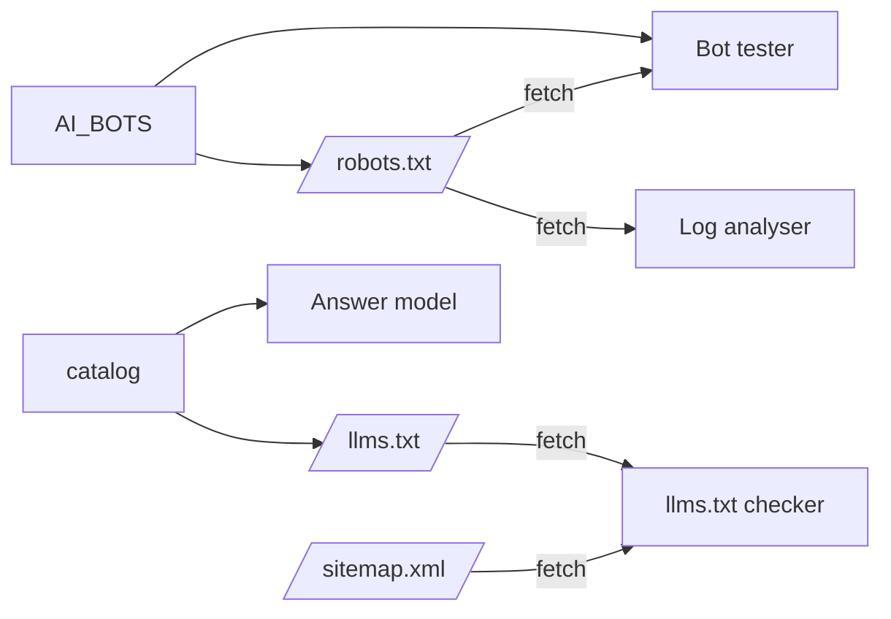

# Technical Design: SEO, SEO for AI search and LLMs

## Scope

In: one shared list of documented AI bots; `robots.ts` rules built from it (training and control tokens disallowed, search and user-request bots allowed, existing `*` group and sitemap kept); a build-time `/llms.txt` route built from the catalog; the page `/seo/ai-search` with five topics and five demos; catalog, README and section copy marking the page written.
Out: `llms-full.txt` or Markdown copies of pages, `Content-Usage` or `Content-signal` lines in the live file, Cloudflare settings, bots without a vendor page (see decisions.md).

## Research Summary

> From .artifacts/research/ai-search.md (checked 2026-10-22)

- Bots split into training, search index and user request; Google-Extended and Applebot-Extended are control tokens that crawl nothing. OpenAI, Perplexity, Google, Meta and Amazon say their user fetchers may ignore robots.txt; Anthropic says all its bots honor it.
- AI Overviews and AI Mode use Googlebot and the index with no extra requirements; Google-Extended doesn't affect them; the Search Console generative AI setting (default include) and snippet controls do. Bing: `noarchive` keeps content out of Copilot, `nocache` limits it to URL, title and snippet.
- llms.txt is an informal proposal (v2, August 2026); only the H1 is required; `llms-full.txt` isn't in it; Google Search ignores it.
- IETF aipref (`train-ai`, `ai-use`, `search`; `Content-Usage`) are drafts; Cloudflare Content Signals use different labels; no vendor documents honoring either.
- Next.js: `rules` is an array and `userAgent` can be an array (emitted as consecutive `User-Agent` lines sharing one group); `robots.ts` can't emit comments; GET route handlers are dynamic by default, so `/llms.txt` needs `dynamic = "force-static"`.

## Patterns & Reuse

### Conventions to Follow

| Pattern | Project Uses | Avoid | Reference |
|---------|-------------|-------|-----------|
| Topic page | `TopicFrame` + content component with `Topic` per topic, `topic(i)` helper, `linksLabel: "Read more:"` | A custom page shell | src/handbook/seo/metadata/content.tsx:26 |
| Page route | `topicMetadata(slug)` + `TopicFrame page={getTopicPage(slug)}` | Hand-built metadata | src/app/(playground)/seo/metadata-structured-data/page.tsx:1 |
| Live text file | `useText(path)` with `retry`, `FetchError` | Silent fetch failures | src/handbook/seo/crawling/use-text.ts:8 |
| Demo select | `FieldSelect` | Native select | src/handbook/seo/field-select.tsx:11 |
| Verdicts | `Verdict` (icon and text) | Colour-only status | src/handbook/ui |
| Handlers | Named `handleX` above `return`; static samples as module consts | Multi-line inline handlers | .claude/rules/05-event-handlers.md |

### Existing Code to Reuse

| Component | Location | How to Use |
|-----------|----------|------------|
| `parseRobots`, `checkRobots` | src/handbook/seo/crawling/robots-txt.ts:19, :77 | Import for the bot tester and the log demo's disallowed-path check |
| `parseSitemap`, `localPath`, `runPool` | src/handbook/seo/crawling/sitemap.ts:6, :15, :21 | llms.txt link checks against the sitemap |
| `CodeBlock` | src/handbook/e2e/code-block | Show the live files |
| Catalog lists | `practices`, `sections`, `sectionPages`, `topicPages`, `practiceHref`, `topicHref`, `sectionPath`, `PRACTICES_PATH` | Build llms.txt with the same filters as src/app/sitemap.ts:12 |

## Data Model

### Entities

| Entity | Purpose |
|--------|---------|
| `AI_BOTS` (new, src/lib/ai-bots.ts, shared by server and client) | token, vendor, job (`training`, `search`, `user`, `control`), `mayIgnoreRobots`, source URL |
| `llmsTxt()` (new, src/lib/llms-txt.ts) | the file's text from the catalog |
| Answer model (new, client) | page index (title, summary, path), fan-out, per-engine eligibility |
| Controls model (new, client) | controls, goal presets, outcome per vendor and generated lines |
| llms.txt checker (new, client) | parse into H1, summary, sections and links with line numbers; problems |
| Log model (new, client) | parse combined log lines; classify by bot token; sample IP ranges per vendor |

#### AI_BOTS

Training: GPTBot (OpenAI), ClaudeBot (Anthropic), CCBot (Common Crawl), meta-externalagent (Meta), Amazonbot (Amazon), MistralAI-Training (Mistral). Control: Google-Extended (Google), Applebot-Extended (Apple). Search: OAI-SearchBot, Claude-SearchBot, PerplexityBot, Meta-WebIndexer, Amzn-SearchBot, DuckAssistBot, MistralAI-Index. User: ChatGPT-User, Claude-User, Perplexity-User, Meta-ExternalFetcher, Amzn-User, MistralAI-User (`mayIgnoreRobots` true for ChatGPT-User, Perplexity-User, Meta-ExternalFetcher, Amzn-User). Googlebot, Bingbot and Applebot are listed in the tester as `search` with a note that they also feed normal search, and are not given groups in the live file.

### API Contracts

| Endpoint | Method | Response |
|----------|--------|----------|
| /robots.txt | GET | `User-agent: *` `Allow: /`; one group per training and control token with `Disallow: /`; one group per search and user bot with `Allow: /`; `Sitemap:` line |
| /llms.txt | GET | `text/plain; charset=utf-8`, prerendered. `# Frontend Handbook`, `> {home description}`, then `## React Practices` and one `## {section}` per section with written pages; each list starts with the section page, then `- [Title](absolute URL): summary` |

## Decisions

| Decision | Rationale |
|----------|-----------|
| One bot list in `src/lib` feeds `robots.ts` and the demos | The tester and the live file can't drift; every bot carries its source |
| One group for the training and control tokens, one for the search and user bots | Next.js writes an array as consecutive User-Agent lines, which robots.txt treats as one group per line set |
| No comment lines in robots.txt | `robots.ts` has no comment field; the page explains the policy |
| llms.txt as a route handler with `force-static`, not a file in `public/` | Built from the catalog so it can't go stale; `public` would be hand-written |
| Sample IP ranges use the RFC 5737 documentation networks (192.0.2.0/24, 198.51.100.0/24, 203.0.113.0/24) | Clearly not real vendor ranges; the demo labels them and links the real lists |
| Answer model: keyword overlap over title and summary, fan-out = the question plus one search per pair of key terms, top three pages cited per engine | Simple enough to state in an assumptions list; labelled as a model |
| Answer engines in the model: Google AI Overviews (Googlebot, indexed, snippet allowed, site included), ChatGPT search (OAI-SearchBot), Claude (Claude-SearchBot); a GPTBot toggle changes nothing | Shows the training/search split directly |
| Controls outcomes use "yes", "no", "limited" and "no documented control"; unconfirmed vendor claims carry a note | Matches the research, including its gaps |

## Component Design

| Component | File | Action | Responsibility |
|-----------|------|--------|----------------|
| Bot list | src/lib/ai-bots.ts | new | AI_BOTS, tokens by job |
| robots | src/app/robots.ts | modify | Groups from AI_BOTS |
| llms.txt | src/lib/llms-txt.ts, src/app/llms.txt/route.ts | new | Build and serve the file |
| Bot tester | src/handbook/seo/ai-search/bots-demo.tsx | new | AC-004 |
| Answer model | src/handbook/seo/ai-search/answer-model.ts, answer-demo.tsx | new | AC-006 |
| Controls | src/handbook/seo/ai-search/controls.ts, controls-demo.tsx | new | AC-008 |
| llms.txt checker | src/handbook/seo/ai-search/llms-check.ts, llms-demo.tsx | new | AC-010 |
| Log analyser | src/handbook/seo/ai-search/access-log.ts, log-demo.tsx | new | AC-012 |
| Content + route | src/handbook/seo/ai-search/content.tsx, src/app/(playground)/seo/ai-search/page.tsx | new | Five topics |
| Catalog, README | src/practices/catalog.ts, README.md | modify | Mark written with dates; README SEO row |

## Data Flow

## Requirements Traceability

| Requirement | File | Status |
|-------------|------|--------|
| AC-001 | ai-bots.ts, robots.ts | Done |
| AC-002 | llms-txt.ts, llms.txt/route.ts | Done |
| AC-003, AC-004 | content.tsx, bots-demo.tsx | Done |
| AC-005, AC-006 | content.tsx, answer-model.ts, answer-demo.tsx | Done |
| AC-007, AC-008 | content.tsx, controls.ts, controls-demo.tsx | Done |
| AC-009, AC-010 | content.tsx, llms-check.ts, llms-demo.tsx | Done |
| AC-011, AC-012 | content.tsx, access-log.ts, log-demo.tsx | Done |
| AC-013 | content.tsx | Done |

## Test Strategy

- Script against `pnpm start`: parse `/robots.txt` with the project's parser and check every AC-001 bot's verdict for `/` and a deep path, plus `*` and the sitemap line; compare `/llms.txt` links with the sitemap both ways; `content-type` is text/plain.
- Run the checker on the live `llms.txt`: no problems.
- Browser: each demo's states and edge cases (bad robots line, no matching group, no matching page, empty llms.txt, unparsed log line, fetch failure); How search works crawler view and the crawling robots tester still work; axe light and dark, 360 px; quality gates.

## Considerations

- Error handling: every live fetch goes through `useText` or the same retry pattern.
- Security: pasted text is only parsed and rendered as text, never as HTML.
- The live site serves an older build, so verification runs locally; the page says nothing about the live file being up to date.

## Open Questions

- None
